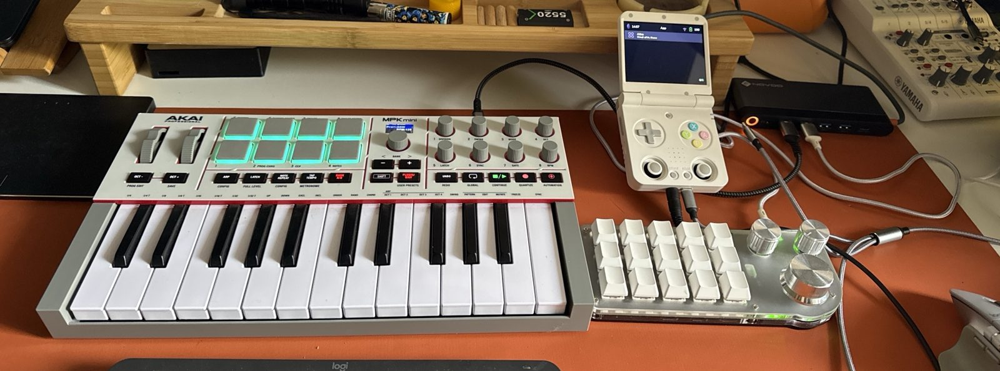
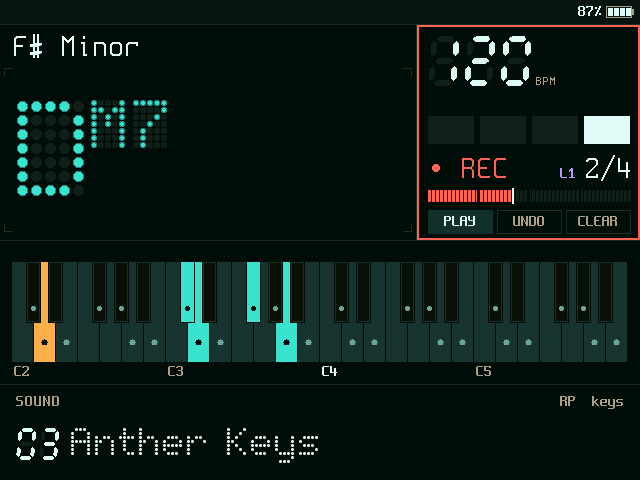
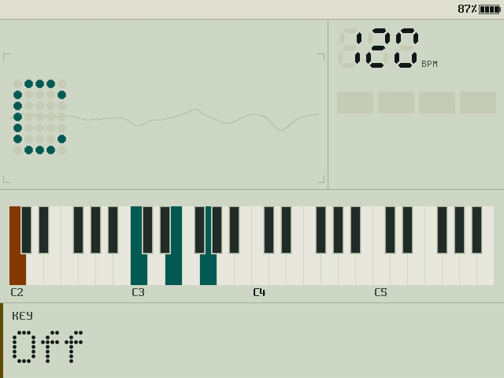
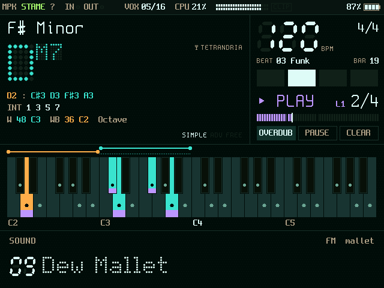

<p align="center">
  
</p>

# Stame

**A faithful, open clone of the Orchid chord synth, grown on a handheld.**

*English · [Italiano](README.it.md)* · **Website:** https://luigismith.github.io/stame/

Hold a chord button, press one key, and a voiced chord with its bass comes out. The [Orchid](https://telepathicinstruments.com/) by Telepathic Instruments does that, plus strums, arpeggios, patterns, a beat and a looper. **Stame** does the same — all of it, from the voicing windows to the Secret Chords — on a **Miyoo Flip** handheld, played with an **Akai MPK mini IV** and a fifteen-key **macro pad**. Then, having more keys, more knobs and more CPU than the original, it does a little more.

The name comes from the flower: the Orchid's editor is called *Pistil*; the stamen is the other half. The rest of the identity comes from a 1970s greenhouse (*The Secret Life of Plants*, Mort Garson's *Plantasia*) and from Linnaeus, who classified plants by counting stamens. One note is one stamen: a triad is *Triandria*, and that is what the boot screen says.

> **Status:** phase 1, *showcase 0.1* running on the Flip: it plays, it loops, it has a demo. Phase 2 will move the same core to dedicated hardware. Independent project, not affiliated with Telepathic Instruments; no factory data of the original is in this repository.

<p align="center">
  
</p>
<p align="center">
  
  
  
  
  
  
</p>

## Playing it, in three lines

1. **Hold a pad, press a key.** Top row Dim, Min, Maj, Sus; bottom row the extensions 6, m7, M7, 9. The key gives the root; the big knob of the macro pad moves the voicing window.
2. **Turn a knob, the band answers.** K1 Sound, K2 Perform, K3 FX, K4 Key, K5 Bass, K6 Loop, K7 BPM, K8 Volume; press the twin key on the pad (T1–T8) to «push» it. T13 is a Lock, like Caps Lock: the pad's three detented knobs become Sound, Perform and Key.
3. **REC, play four bars, ⊕ to overdub.** The MPK's transport buttons are the looper; STOP/PLAY starts the beat. T12 held for one second is Panic, three seconds is Reset.

The Italian [manual](docs/manuale/manuale.md) and the one-page [quick reference](docs/manuale/prontuario.md) have everything else.

## What is inside

- **The sound.** Two engines (Sound and Bass) on sixteen voices at 48 kHz, three synth models that follow the original — VA, FM and a physical-model Reed Piano — plus a Stame addition, the **SMP sampler**, which plays an 88 MB bank of CC0 samples: pianos (Kawai grand, two uprights, TX81Z FM piano and Clavisynth), harpsichords, four pipe-organ stops, recorders from soprano to bass, ocarina, harmonicas, tenor sax and saxello, didgeridoo, harp, strumstick, đàn tranh, psaltery, three lamellophones, vibraphone, marimba, balafon, xylophone, glockenspiel, tubular bells, hand chimes, wine glasses. Two FX slots per engine, delay, reverb. Seventy-nine sounds (37 synth, 42 sampled) and twelve basses, designed for Stame, no preset of the original.
- **Performances:** Strum, Strum 2 Octaves, Slop, Arpeggiate (1 and 2 octaves), Pattern, Harp, with a Lock. **Beat:** twelve patterns with three sampled kits (Studio, Jazz, 808) and a synthesized CR-78-style kit. **Looper:** a loop of events, four bars with a count-in, overdub, pause, undo, clear.
- **The panel.** A 640×480 «calm» panel: chord, tempo, keyboard and the control just touched; the eleven controls and the detail arrive on request. Six views, two themes (Night, a VFD; Day, a reflective LCD), a dot-matrix font and seven-segment digits drawn for Stame. See [docs/identita](docs/identita/README.md).
- **The demo.** Twenty seconds without input and Stame plays its four original pieces in turn («Acacia», «Felce», «Pistillo», «Alga»), showing every gesture on the panel: chords, bass, loop and overdubs, a drum loop played on the keys, sampled piano, vibraphone, kalimba, sax, organ and bells, the two themes, a ritardando.
- **The core is portable.** `src/core`, `src/dsp`, `src/ui`, `src/gfx` and `src/ui_flip` are plain C11: no heap, no I/O, no SDL in the audio path. Everything platform-specific lives in `src/platform/`. The portability check compiles the core as freestanding Cortex-M7 code, so phase 2 stays honest.

### Specified, not built yet

Saving User Sounds and loading a private factory bank; Waiting Room and loop length, loop slots, soft and hard exit; drums on the keys and the other Mod combinations; MIDI out on the DIN port, clock and external control; Pocket Mode, Learn Pad, the MPK status page; the case (designed, not cut); phase 2 hardware. The full list, requirement by requirement, is in the specification.

## Build and install

Needs: a Miyoo Flip with a spruceOS-based firmware, an Akai MPK mini IV in its **DAW** preset, optionally the macro pad on a plain USB 2.0 hub (no Power Delivery) on the Flip's top USB-C port. On the PC: Git Bash on Windows, [Zig](https://ziglang.org/) 0.17 (`zig cc` is the C compiler, also for aarch64), the SDL2 headers, Python 3 with `numpy` and `soundfile` for the sample bank.

```sh
sh tools/build.sh test          # core unit tests on the PC
sh tools/build.sh portabilita   # allowed headers, poisoned symbols, Cortex-M7 trial build
sh tools/build.sh render        # offline renderer: PNG frames and WAV of the demo
python -I tools/campioni.py     # downloads the CC0 samples and builds build/campioni/stame.smp (once)
sh tools/build.sh pacchetto     # the app for the Flip in build/pacchetto/App/Stame
sh tools/deploy.sh              # copies it over SSH (the Flip's address in tools/flip.ip, not in git)
```

`test` and `portabilita` must pass before every commit. On the Flip, Stame appears under **App › Musica** (**App › Altro** on a menu without areas). Without the sample bank the sampled sounds and kits stay silent; everything else plays.

## Documents

| | |
|---|---|
| [docs/specifica](docs/specifica/00-panoramica.md) | the functional specification, written before the code: chords and performance, sound, interface, MIDI and controls, the Flip platform, the case. Every requirement has an ID and a source tag ([M] manual, [O] observed, [D] deduced, [V] to verify on a real unit); conventions in [CONVENZIONI.md](docs/specifica/CONVENZIONI.md) |
| [docs/manuale](docs/manuale/manuale.md) | the user manual and the [quick reference](docs/manuale/prontuario.md) (Italian) |
| [docs/identita](docs/identita/README.md) | the identity: story, mark, themes, fonts, boot, sound logo |
| [hardware/case](hardware/case/README.md) | the case, draft 3: birch plywood, engraved black acrylic, PETG; generated by `genera.py` ([spec](docs/specifica/60-case.md)) |
| [docs/disegni](docs/disegni/README.md) | the drawings of the panel and controls |

## Credits and licences

- Stame (code, specification, identity, case) is released under the [MIT licence](LICENSE), © 2026 Luigi Massari.
- The sample bank uses only **CC0** samples: the [Versilian Community Sample Library](https://github.com/sgossner/VCSL) and the [Sonic Pi](https://github.com/sonic-pi-net/sonic-pi/tree/dev/etc/samples) sample set from freesound.org. Every file is listed in [assets/campioni/FONTI.md](assets/campioni/FONTI.md).
- The [Spleen](third_party/spleen/LICENSE) bitmap font, BSD 2-Clause, © Frederic Cambus.
- **Orchid** and **Pistil** are names of Telepathic Instruments. Stame is an independent project, not affiliated with or endorsed by them. The repository holds no factory data of the original (no presets, no firmware, no recordings of its sounds): its behaviour is described from the public manual and from listening, and every requirement says where it comes from. If you own an Orchid, the questions marked [V] in the specification are the ones only you can answer.
