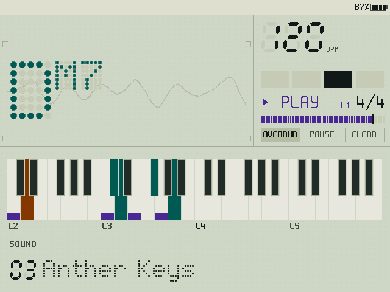
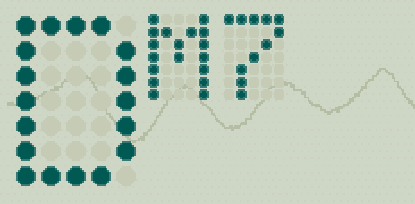
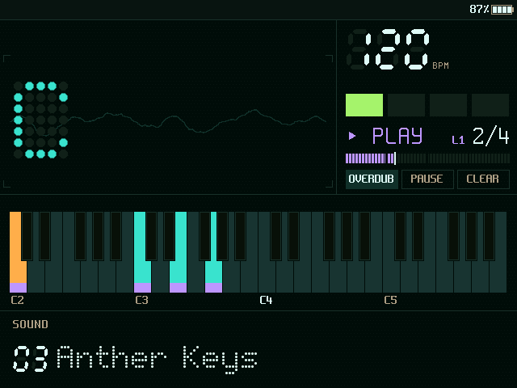
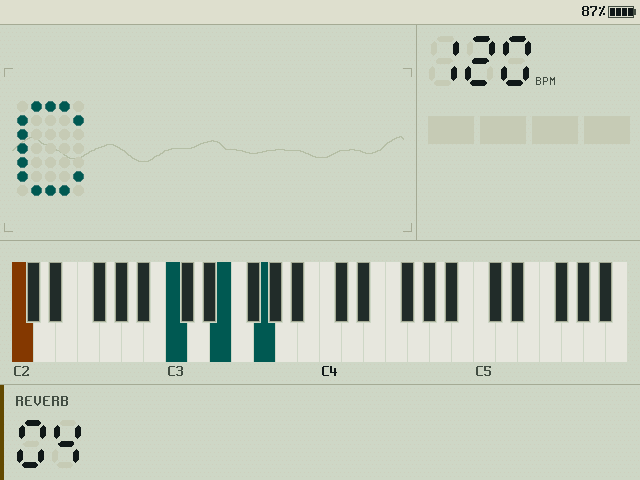
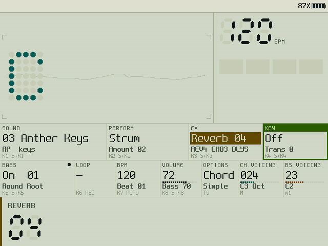
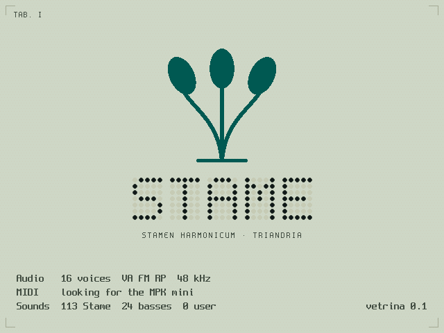
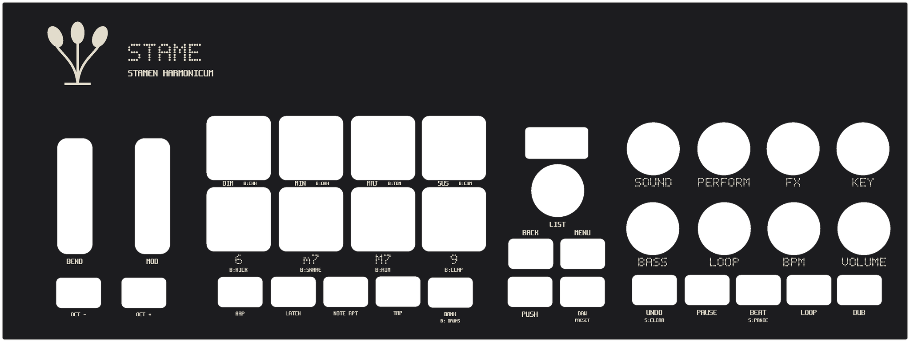

# Stame — identità

Bozza 2, 15/10/2026: la plancia diventa calma (§3.1). Bozza 1, 14/10/2026. Questo documento fissa il carattere di Stame: la storia, il marchio, la plancia sulla Flip, il case e il suono. Il comportamento resta quello della specifica (sezioni 10–40). Qui si decide solo come Stame si presenta.

Dove sta nel codice:
- **plancia**: `src/ui_flip/` (zone, tema, avvio) e `src/gfx/` (primitive, Matrice, sette segmenti);
- **font**: `tools/matrice.py` (Matrice), `tools/simboli.py` (simboli), `tools/bdf2c.py` (Spleen);
- **case**: `hardware/case/` (misure, generatore dei pezzi, modello 3D);
- **suono**: `assets/suoni/` (logo sonoro e sessione di SoundCraft).

## 1. La storia

**Il nome.** In un fiore lo stame porta il polline e il pistillo lo riceve: Stame è la parte che dà.

**La serra.** Negli anni Settanta si credeva che le piante crescessero meglio con la musica. Nel 1973 uscì *The Secret Life of Plants*; nel 1976 Mort Garson incise *Plantasia*, musica per Moog «per le piante e per chi le ama». Stame è lo strumento che quella serra avrebbe avuto: un sintetizzatore ad accordi con il pannello di legno e un display che si accende come un vetrino al microscopio.

**La specie.** Nel 1735 Linneo classificò le piante contando gli stami: un solo stame, *Monandria*; due, *Diandria*; tre, *Triandria*. Stame ne prende la regola: **una nota è uno stame**. Una triade è *Triandria*, un accordo di settima *Tetrandria*. Il nome scientifico dello strumento è *Stamen harmonicum*, classe *Triandria*.

Da qui vengono tutte le scelte che seguono:
- un accordo è una fioritura, e le note sono granelli di polline;
- il display è un vetrino: vetro scuro, segni che si accendono, etichette da tavola botanica;
- il marchio è fatto di tre stami, cioè di tre note.

## 2. Il marchio

Tre stami salgono da un ricettacolo comune: il filamento centrale è dritto, i due laterali si aprono ad arco. Ogni antera è un ovale inclinato come la testa di una nota. Si legge come un fiore e come un accordo di tre note.

| Uso | Forma |
|---|---|
| icona dell'app (70×70, PLT-083) | oro (215, 180, 95) su fondo trasparente |
| avvio della plancia | fosforo acqua, le antere si accendono una alla volta |
| case: ponte, fianchi, mascherina | inciso al laser |
| simbolo nel testo | U+E000 nel font dei simboli (cartellino di Linneo) |

Le proporzioni sono uguali ovunque: `ui_flip_logo()` in `src/ui_flip/avvio.c` e `logo()` in `hardware/case/genera.py`.

La scritta **STAME** si compone sempre in Matrice (§3.2): a punti sullo schermo, a fori incisi sul legno e sull'acrilico.

## 3. La plancia: il vetrino a fluorescenza

### 3.1 Principi

Il 15/10/2026 Luigi ha guardato le prime immagini e ha chiesto se servissero davvero tutte quelle informazioni. Non servivano: a un braccio di distanza si leggevano solo il nome dell'accordo e il BPM, e metà dello schermo ripeteva ciò che il case incide accanto ai comandi. Da qui i primi tre principi.

1. **Calma.** Mentre si suona il vetrino mostra quattro cose: l'accordo, il tempo, la tastiera e, in fondo, il controllo appena toccato (a riposo, il suono). Tutto ciò che si vede deve leggersi a 50–70 cm: maiuscole alte almeno 3 mm. Il resto arriva quando serve: le 11 celle dei comandi con i tasti del fuoco della Flip, il dettaglio nella vista Geek Out (specifica 30, UI-140).
2. **Il case porta i nomi, lo schermo i valori.** La mascherina incide accanto a ogni comando la sua funzione, nello stesso color sabbia delle scritte stampate sul vetro. Lo schermo non ripete le legende: quando giri una manopola, risponde con il nome e il valore in grande, come l'overlay dell'originale.
3. **Lo stato tace.** Se va tutto bene la testata è vuota, a parte la batteria. Un problema si accende in rosso solo finché dura.
4. **Due inchiostri.** Le scritte fisse (titoli delle celle, BPM, BAR, KEY, i nomi dei tasti) sono stampate sul vetro in color sabbia, come la serigrafia di uno strumento d'epoca. I valori che cambiano si accendono nei colori dei fosfori. Così si vede subito cosa è etichetta e cosa è stato.
5. **I segmenti spenti restano visibili.** Come su un display a fluorescenza (VFD), ogni cifra e ogni lettera del nome dell'accordo mostra anche i suoi punti spenti. Le parole lunghe della banda no: diventerebbero una griglia. Ogni informazione ha un posto fisso (UI-140), e il posto si vede anche quando è vuoto.
6. **Il vetro ha una maglia.** Il fondo è nero appena verde, con un punto più chiaro ogni 4 pixel a righe sfalsate: la griglia dei VFD.
7. **Il colore ha un ruolo fisso** e sempre una forma che lo accompagna (UI-140 punto 8). Treble acqua, basso ambra, looper viola, fuoco lime, evidenze gialle, avvisi rossi.
8. **Il nome dell'accordo parla come la tastiera.** L'accordo è nel colore treble e il basso dopo la barra nel colore bass: gli stessi colori dei tasti accesi.

### 3.2 Caratteri

| Carattere | Dove | Perché |
|---|---|---|
| **Matrice** 5×7, punti tondi (di Stame) | nome dell'accordo, valore del controllo toccato nella banda, scritta STAME, legende principali del case | è il carattere dei moduli VFD; si legge da un metro |
| **Sette segmenti**, inclinati di 5° | BPM, numeri della banda («Voicing 032», «Reverb 06») | i numeri che cambiano mentre si suona, come su un frequenzimetro |
| **Spleen** (BSD 2-Clause) 6×12 … 32×64 | tutto il resto del testo | bitmap nitida, senza sfumature, economica da disegnare |
| **Simboli di Stame** | ♯ ♭ ✓ ✚ ▶ ◀ ● ○ — e il marchio | Spleen non li ha; disegnati nelle stesse celle |

Matrice è stato disegnato per Stame: 78 glifi, larghezza da 1 a 5 punti, due righe di discendente. Il diesis e il bemolle sono pensati per stare accanto alle maiuscole. I punti hanno il centro pieno e il bordo mescolato con il fondo, così sembrano accesi.

### 3.3 Palette

Due temi, due tecnologie di display dell'epoca. **Giorno** (il default dal 15/10/2026) è un LCD riflettente: fondo grigio-verde e inchiostri scuri. **Notte** è un VFD: vetro scuro e fosfori. Stessi ruoli, stesse forme.

| Token | Ruolo | Giorno | Notte |
|---|---|---|---|
| `bg` | vetro | `#CED4C2` | `#050C0B` |
| `mesh` | maglia del vetro | `#C8CEBB` | `#0A1614` |
| `panel` | intestazioni e liste | `#D9DECE` | `#0A1715` |
| `line` | separatori | `#A2AA95` | `#1B302C` |
| `seg_off` | segmenti e punti spenti | `#C1C8B4` | `#10221F` |
| `bar` | barre e celle | `#B5BDA7` | `#123029` |
| `ghost` | accordo passato, legende dei comandi | `#879180` | `#3F655D` |
| `text` | valori accesi | `#141B18` | `#DDFBF1` |
| `dim` | scritte stampate (sabbia) | `#424C47` | `#A99F86` |
| `treble` | accordo, note treble, finestra del voicing | `#005A51` | `#3FE3CB` |
| `bass` | basso | `#853A00` | `#FFAE4A` |
| `loop` | looper | `#4A2894` | `#B996FF` |
| `focus` | fuoco, primo movimento, MPK STAME | `#285C00` | `#A4F06A` |
| `active` | evidenze, transpose, LOCK | `#634A00` | `#FFDD5E` |
| `warn` | registrazione, clip, avvisi | `#9E160C` | `#FF6156` |
| `kb_white` / `kb_black` | tasti spenti | `#E3E7D8` / `#252D29` | `#183632` / `#08110F` |
| `in_key` | granelli di polline | `#424C47` | `#6FA597` |

Contrasti (WCAG, controllati da `tests/unit/test_plancia.c`, T-UI-20): ogni token di testo ha almeno 4,5:1 sul vetro e sui pannelli, i ruoli almeno 3:1 sui tasti bianchi, `ghost` fra 2 e 3,5:1, i segmenti spenti fra 1,05 e 1,6:1 (si intuiscono, non si leggono).

### 3.4 Elementi propri

- **Cartellino di Linneo.** Nella vista Geek Out, in alto a destra della zona accordo: il marchio piccolo e la classe dell'accordo che suona («TRIANDRIA», «TETRANDRIA»…), contata sulle classi di nota. Dal 15/10/2026 non sta più nella vista Chord: è un dettaglio da guardare da vicino. Si spegne dal menu della piattaforma (*Linnaeus Tag*).
- **Granelli di polline.** Le note della tonalità hanno un punto tondo sul tasto, scuro se il tasto è acceso.
- **Filamenti del voicing.** Le finestre del voicing sopra la tastiera sono un filamento con un'antera tonda a ogni capo: treble in acqua, basso in ambra. Compaiono mentre si gira un voicing e in Geek Out.
- **Vetrino.** Il nome dell'accordo sta dentro quattro angoli a squadra, come un preparato al microscopio.
- **Barre a celle.** Livello, giro del looper, volume e voicing sono barre di celle: si accendono, non si riempiono.
- **La banda.** In fondo al vetrino, una riga che risponde alla mano: il controllo appena toccato in grande, con un segno giallo a sinistra; a riposo il suono, un gradino più piccolo. Le funzioni secondarie (premi e gira) hanno l'etichetta in negativo, come il tasto tenuto.

### 3.5 Avvio

Sul vetro, in 2,6 secondi:
1. 0–800 ms: i tre filamenti crescono dal ricettacolo;
2. 800, 1000, 1200 ms: le antere si accendono una alla volta, dalla più bassa (con il logo sonoro, §5);
3. dai 1200 ms: STAME si accende lettera per lettera, prima a celle spente;
4. dai 1600 ms: «STAMEN HARMONICUM · TRIANDRIA» e le righe dell'inizializzazione.

Agli angoli dello schermo ci sono le squadre di una tavola botanica, e in alto «TAB. I».

## 4. Il case: la console

Il case parla la stessa lingua dello schermo. Le legende incise usano Matrice (funzioni principali) e Spleen (legende piccole); il marchio è lo stesso; la sabbia delle scritte stampate diventa l'incisione sull'acrilico nero.

| Materiale | Dove | Richiama |
|---|---|---|
| betulla, compensato 4–6 mm | fianchi, retro, costola, parete davanti, base | il legno degli strumenti anni Settanta |
| acrilico nero 3 mm, inciso | il piano: mascherina della MK4 e piano della Flip | il vetro del display; l'incisione chiara è la serigrafia sabbia |
| PETG nero | culle della Flip e del pad, visiera, squadrette | la cornice del vetrino |
| tasti trasparenti con etichette di carta | tasti del macro pad | le scritte della plancia, a punti Matrice |

Integrazione della MPK mini IV (bozza 5, 18/10/2026):
- **il piano nero** va da un fianco all'altro alla stessa quota: tutto coperto e omogeneo, hub e cavi sotto;
- **la mascherina** appoggia sul pannello comandi e ha un foro per ogni controllo: dà a ogni comando il nome della sua funzione in Stame (SOUND, PERFORM… sulle manopole; DIM, MIN, MAJ, SUS e 6, m7, M7, 9 sui pad) e, piccolo, il suo nome ai controlli che Stame non usa;
- **i fianchi di betulla** coprono le guance rosse della MK4, e la **costola** chiude il lato verso il macro pad;
- **le culle** della Flip e del pad hanno lo stesso bordo: i due apparecchi stanno sul piano allo stesso modo;
- **la visiera** attorno allo schermo della Flip lo fa sembrare il display della console, come la cappa di un oscilloscopio;
- **i colori dei pad** (CASE-033, con Note On sul canale 7, senza SysEx; prima prova con Luigi davanti): pad degli accordi in acqua, estensioni in bianco.

Dettagli, misure e pezzi in `docs/specifica/60-case.md` e `hardware/case/README.md`.

## 5. Il suono

**Logo sonoro**: tre note che salgono come le tre antere che si accendono. Mi3, Si3, Sol♯4 a 0, 200 e 400 ms, poi un Mi5 leggero a 650 ms, il granello di polline. Le classi di nota restano tre: *Triandria*. Il timbro è una campana tenue (triangolo e sinusoide all'ottava, filtro che si chiude), con chorus lento, eco a 375 ms e riverbero a piastra di 3,4 s. Dura 5,5 s, a −12 LUFS.

- File: `assets/suoni/stame_avvio.wav` (48 kHz, 16 bit).
- Sorgente: `assets/suoni/stame_avvio.sc.txt`, il copione per `soundcraft-cli script`, più la sessione `stame_avvio.scraft` da aprire in SoundCraft.
- **Nella vetrina** suona una volta all'avvio. **Nello Stame vero** sarà un'opzione (*Boot Sound*) spenta per default: prima la fedeltà all'originale.

## 6. Regole d'uso

- I testi sullo schermo restano in inglese (sezione 30, §0.4). Il latino vale solo per le etichette della storia: STAMEN HARMONICUM, TRIANDRIA, TAB. I.
- Nessun nuovo colore: ogni colore ha un ruolo (§3.3). Un'informazione nuova prende il ruolo che le spetta.
- Le scritte fisse sono sabbia, i valori sono fosfori. Mai il contrario.
- Il marchio non si deforma e non si colora fuori dai colori della tabella del §2.
- Niente nomi, loghi o marchi di altri, né sullo schermo né sul case.
- Ogni grafica nuova passa dal renderer offline (`stame-render`) e dai test dei contrasti prima di arrivare sulla Flip.
