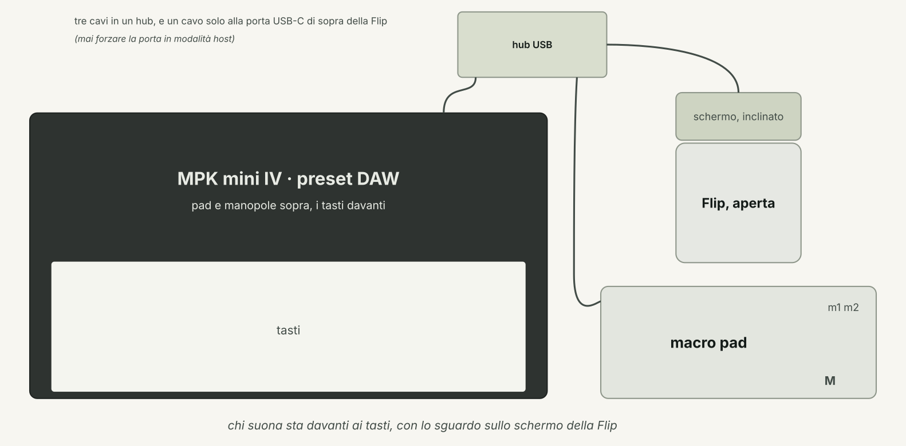
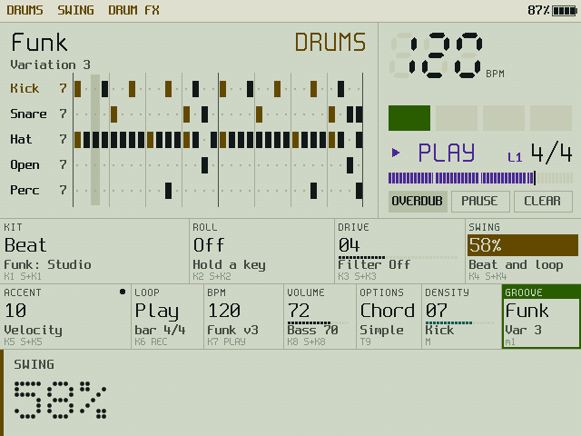
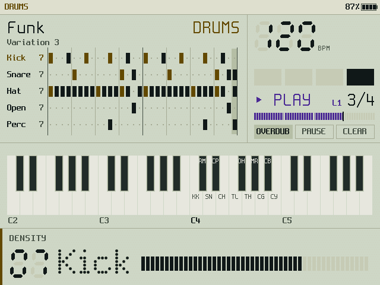
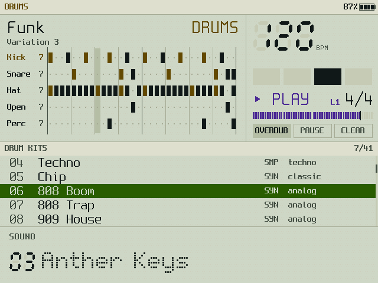
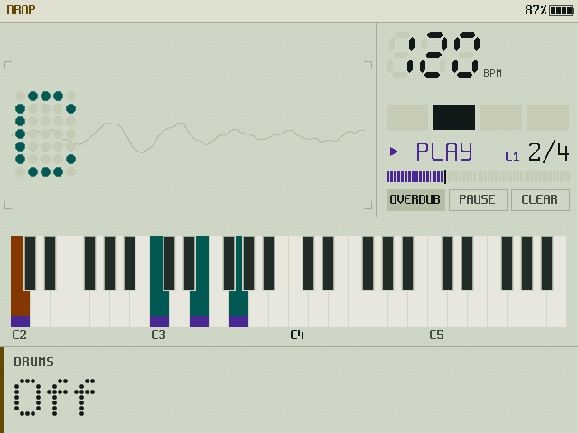
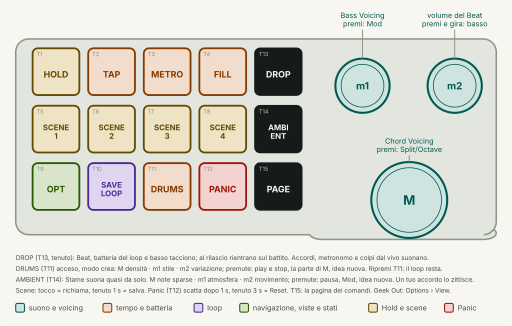
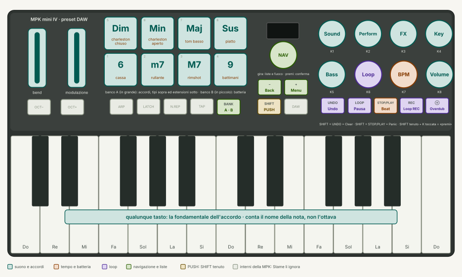
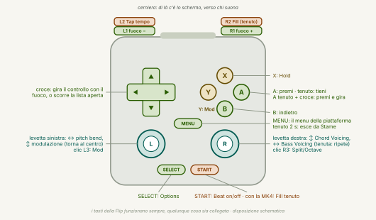
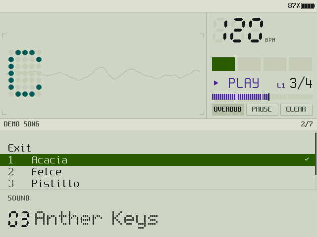

# Stame — manuale d'uso

Bozza 1, 15/10/2026. Per chi suona, non per chi programma: la [specifica](../specifica/00-panoramica.md) sta in `docs/specifica/`; tutti i comandi in un foglio da stampare sono nel [prontuario](prontuario.md).

Stame è uno strumento ad accordi: una mano tiene il tipo d'accordo e le estensioni, l'altra suona la fondamentale, ed esce un accordo intero con il suo voicing e il suo basso; le performance lo fanno muovere, il Beat e il looper fanno i loop mentre suoni. Tutto si suona, niente si programma a passi. E, avendo più tasti, più manopole e più potenza di uno strumento dedicato, Stame fa qualcosa in più. Nella fase 1 vive sulla **Miyoo Flip** (schermo e cervello) e si suona con la **Akai MPK mini IV** (tasti, pad e manopole) e un **macro pad** a 15 tasti e 3 manopole. Questo manuale descrive la **vetrina 0.1**, cioè quello che oggi gira sulla Flip; dove la specifica prevede di più, lo dice con un **«previsto»**.

## 1. La postazione

- **MPK mini IV a sinistra**, nel preset **DAW** (è di fabbrica, non va programmato). La sinistra sta sugli 8 pad, la destra sui tasti; le 8 manopole K1…K8 sono sopra i tasti, a destra; sotto le manopole, il trasporto (UNDO, LOOP, STOP/PLAY, REC, ⊕).
- **Macro pad a destra**, in linea con i tasti, con le manopole verso destra: le due piccole in alto (**m1** vicina ai tasti, **m2** sul bordo), la grande **M** in basso. Si usa solo via cavo, sullo strato di fabbrica 3 (o sull'1, reso uguale al 3).
- **Flip sopra il pad**, aperta, con lo schermo verso chi suona: è un display a portata di sguardo, fuori dalle mani. I suoi tasti funzionano sempre, qualunque cosa sia collegata: sono la console di gestione (§9.2).
- MPK e pad entrano in un **hub USB 2.0 semplice, senza Power Delivery**, sulla porta USB-C **di sopra** della Flip. Mai forzare la porta in modalità host dal sistema: Stame non lo fa e non va fatto a mano.

### 1.1 Uno strumento solo

Stame si suona con MK4, pad e Flip insieme: ogni comando ha una casa sola (§7, §8, §9). Se manca un apparecchio, gli altri fanno lo stesso mestiere di sempre e i suoi comandi mancano: non ci sono mappe speciali per la sola MK4 o il solo pad (18/10/2026). I tasti della Flip funzionano sempre, e i due voicing hanno sempre una manopola nella levetta destra della Flip.

## 2. Accendere e spegnere

1. Sulla Flip: **App › Musica › Stame**. Per 2,6 secondi il vetrino mostra i tre stami che si accendono, con il logo sonoro, e le righe dell'inizializzazione.
2. Se non tocchi niente, **parte la demo** (i brani «Acacia», «Felce» e «Pistillo», a giro). Un tasto, un pad o una nota la fermano e lo strumento è tuo.
3. Per uscire: **MENU › Quit Stame** (esce subito, senza conferma). Uscita di sicurezza: **MENU tenuto 2 secondi**. Accensione e spegnimento della Flip e il volume di sistema restano a spruceOS.

Lo stato della MPK e del pad si vede nella testata, in alto: a riposo c'è solo la batteria; «NO MPK» lampeggia finché la tastiera non c'è; «PAD» in rosso vuol dire che il macro pad non si apre o manda codici sconosciuti (§10).

## 3. Suonare un accordo

- **Pad = tipo ed estensione.** Fila in alto, da sinistra: **Dim, Min, Maj, Sus**. Fila in basso: **6, m7, M7, 9**. Tieni un tipo e premi un tasto: suona l'accordo con quella fondamentale. Un'estensione aggiunge sempre lo stesso intervallo (il 6 non diventa 13; la 9 è la seconda, dentro la finestra). Dim + m7 dà il semidiminuito.
- **Tasti = fondamentale.** Conta solo il nome della nota: l'ottava del tasto e OCT−/OCT+ della MPK non cambiano nulla, perché il registro lo decide il **Chord Voicing**. La tastiera è monofonica: un tasto nuovo sostituisce il precedente. Un tasto senza tipo, con la Key mode spenta, suona una **nota singola**.
- **Chord Voicing (manopola grande M del pad).** Tutte le note dell'accordo cadono in una finestra di un'ottava che parte dalla nota d'inizio: girando in su la nota più bassa sale di un'ottava, in giù la più alta scende; dodici scatti = la stessa voicing un'ottava sopra. Il valore va da 1 a 60 (la banda mostra «VOICING 032 C♯3»). Mentre giri, se l'accordo sta suonando si riattacca.
- **Bass Voicing (m1).** L'ottava del basso, 0…48. Il basso è sempre la fondamentale.
- **Premere M: Split ↔ Octave** per le note singole. In **Octave** i 12 tasti suonano l'ottava che contiene la nota d'inizio; in **Split** la finestra vale anche per le note singole, e il punto di divisione si sposta con il voicing.
- **Key mode (K4 / SHIFT + K4).** Premere Key accende o spegne la tonalità: con la Key mode accesa un tasto senza tipo suona l'accordo del suo grado (Do in Fa♯ minore dà il suo accordo) e la testata della zona accordo scrive la tonalità. Girare Key sceglie la tonalità fra le 42 (e accende la Key mode se era spenta). **Premere e girare Key = Transpose**, ±12 semitoni, su tutta l'uscita, loop compreso. Previsto: Key tenuto + tasto per la scelta rapida (con Min tenuto per la minore).
- **Play Style (Options).** **Simple**: suona ciò che tieni. **Advanced**: l'accordo resta anche se lasci il tipo; le estensioni si aggiungono a quello che suona. **Free**: come Advanced, e l'accordo si può cambiare o riattaccare più volte con il tasto tenuto.
- **Secret Chords (Options):** combinazioni di più tipi tenuti insieme che danno accordi nascosti. Con la voce spenta vale l'ultimo tipo premuto.

## 4. I controlli, uno per uno

Il principio vuole nove encoder che si girano e si premono e due manopole di voicing. Su Stame ogni comando ha **una casa sola** (16/10/2026): il **girare** sta sulle manopole K1…K8 della MPK (senza scatti), il **premere** su **SHIFT + K** della stessa MPK (tieni SHIFT e tocchi la manopola: è «premuta»), le **liste** sulla manopola di navigazione con − (Back) e + (Menu) accanto. Il macro pad tiene Options (T9), i due voicing (M, m1) e le cose che l'originale non ha (§7). I gesti sono quattro:

| Gesto | Come si fa |
|---|---|
| **premi** | SHIFT + K toccata e lasciata (vale al rilascio di SHIFT, così si distingue dal premi-e-gira); T9 e M un tocco |
| **tieni** | SHIFT + K toccata, SHIFT tenuto 1 secondo; scatta alla soglia |
| **premi e gira** | SHIFT + K girata; oppure premi e giri una manopola del pad |
| **gira** | la manopola |

Dove stanno: K1 Sound, K2 Perform, K3 FX, K4 Key / K5 Bass, K6 Loop, K7 BPM, K8 Volume sulla MPK; T9 Options; M Chord Voicing; m1 Bass Voicing. Premere un controllo porta anche il **fuoco** su di lui: da lì la manopola di navigazione della MPK lo gira e lo preme.

| Controllo | Gira | Premi | Tieni 1 s | Premi e gira |
|---|---|---|---|---|
| **Sound** | i 200 suoni: 149 di sintesi (Glass Pollen, Night Greenhouse, Anther Keys, Slow Stamen, Fern Pluck, Copper Reed, Orbit Choir, Moss Strings, Dew Mallet, Tape Fern, Seed Organ, Sun Room, Linnaeus Lead, Petal Brass, Root Drone, Vetro Pad, Moonflower, Thistle Lead, Lichen Organ, Nectar EP, Ivy Pluck, Bramble Brass, Cocoon Pad, Spore Bells, Rootstock, Birch Keys, Pollen Choir, Reed Marsh, Clover Strings, Frost Pad, Cactus Pluck, Heliotrope, Underbrush, Dandelion, Sundew, Lotus Flute, Pine Organ e, cupi e techno, Nightshade, Belladonna, Mandrake Stab, Dub Moss, Acid Nettle, Hogweed Hoover, Cypress Saw, Mycelium, Puffball Pulse, Charred Keys, Charcoal Organ, Tar Drone, Wolfsbane Lead, Datura Bells, Bog Rumble, Blackthorn Sync, Ironwood Perc, Burdock Chords e, ancora più cupi, gravi e acidi, Hemlock Acid, Aconite Square, Mandragora Acid, Yew Shadow, Black Hellebore, Deadnettle Dub, Peat Choir, Spleenwort Organ, Bitterroot Lead, Witchgrass Pulse, Mire Bells, Undertow, Tar Pit Keys, Nightjar Brass, Gravel Stab, Ink Cap Drone e, dal 18/10, Steel Petal, Clav Vine, Ebow Fern, Solina Sedge, Pizzicato Moss, Toy Thicket, Nylon Bramble, i ventuno di sintesi fra i venticinque che sorprendono, §4.1, e dal 19/10 i cinquanta dal 151 al 200, tutti di sintesi, §4.2) e 51 campionati (Grand Piano, Upright Piano, FM Piano, Vibraphone, Marimba, Glockenspiel, Tubular Bells, Concert Harp, Kalimba, Harpsichord, Pipe Organ, Alto Recorder, Tenor Sax, TX Piano, Clavisynth, Knight Upright, Italian Cembalo, Lute Stop, Grand Organ, Flute Organ, Full Organ, Sop. Recorder, Tenor Recorder, Bass Recorder, Ocarina, Harmonica, Chromatic Harp, Saxello, Didgeridoo, Strumstick, Dan Tranh, Bowed Psaltery, Pluck Psaltery, Mbira, Nyunga Nyunga, Kenya Kalimba, Hand Chimes, Tube Glock, Bowed Vibes, Balafon, Xylophone, Wine Glasses, Hothouse Piano, Seedling Box, Harmonium Moss, Sitar Tranh, Harp Rain, Drunk Glasses, Throat Song, Rain Marimba, Megaphone Moss); ogni suono porta il suo Perform | lista dei suoni per nome | previsto: Save / Save As / Delete | — |
| **Perform** | la quantità del modo: Strum, Strum 2 Oct, Slop e Harp 1…10; Arpeggiate e Arp 2 Oct il tipo 1…6; Pattern il numero 1…13; 0 = spento | lista dei modi | **Lock**: il Perform non cambia più al cambio di suono (la cella mostra LOCK) | — |
| **FX** | intensità 0…10 dell'effetto principale del suono (REVERB, CHORUS, ENSEMBLE, PHASER, FLANGER, DRIVE, TREMOLO, DELAY) | mostra l'effetto | **Lock** dell'effetto | — |
| **Key** | la tonalità (accende la Key mode) | Key mode on/off | previsto: scelta rapida | **Transpose** ±12 |
| **Bass** | i 24 bassi (Round Root, Sub Floor, Pluck Bass, Reed Bass, Velvet Sub, Wood Bass, Taproot, Peat Sub, Bark Bass, Pod Bass, Thorn Bass, Moss Sub, Reese Root, Acid Sedge, Henbane Sub, Fen Rumble, Spore Bass, Ironroot, Hemlock 303, Square Acid, Abyss Sub, Growl Reese, Detroit Sub, Coal FM Bass) | basso on/off | previsto: lista dei modi | — |
| **Loop** | con il loop in corso sceglie fra le tre voci in Z3 (OVERDUB, PAUSE, CLEAR o UNDO; STOP, PLAY…) | da fermo **REC** (con un loop messo da parte con T10, lo riprende); altrimenti esegue la voce scelta | previsto: 2 s = Save Loop / uscita morbida (oggi T10 del pad) | — |
| **BPM** | 60…200 (o il **tap tempo** su T2) | Beat o metronomo on/off (anche STOP/PLAY della MPK) | lista: **2/4, 3/4, 4/4, 6/8** (metronomo) e i 60 Beat, ognuno con il suo kit: i diciannove di sempre (**Funk, Bossa, Motorik, Lounge, Shuffle, Halftime, Boom Bap, Disco, Samba, Ballad, Train, Chip, Techno, Dub, Acid, Industrial, Minimal, Electro, Trap**, con i kit studio, jazz, 808, techno e la sintesi Chip) e, dal 19/10, 41 di genere con i kit della libreria sintetizzata (§6.4) | **Beat Volume** 0…99 |
| **Volume** | volume master 0…99 | batteria della Flip | — | **Bass Volume** 0…99 |
| **Options** | cambia la vista (fuori dalla lista) | lista: Exit, View, Play Style, Single Notes, Secret Chords | — | — |
| **Chord Voicing** (M) | finestra ±1 semitono per scatto | Split ↔ Octave | — | — |
| **Bass Voicing** (m1) | ottava del basso | il modificatore **Mod**: Mod + Loop (REC) = uscita forzata dal loop (Clear); Mod + Bass = basso on/off, come Bass da solo; Mod + BPM = batteria a tastiera, che oggi ha il suo tasto T11 | — | — |

Liste: la voce in cima è Exit; la manopola di navigazione scorre, premuta sceglie, − chiude (senza MPK: croce, A e B della Flip). Una lista si chiude da sola dopo 10 secondi, e si chiude anche toccando un altro controllo. Ogni controllo toccato accende la **banda** in fondo allo schermo con il suo nome e valore in grande: è l'overlay dell'originale, che qui non copre l'accordo.

### 4.1 I suoni che sorprendono (126–150)

Dal 126 al 150 ogni suono fa una cosa che non ti aspetti. Sono fatti con il motore di sempre (matrice, LFO, inviluppi, filtro, campioni), senza trucchi fuori dal synth. Provali con un accordo tenuto.

| N. | Suono | Cosa fa |
|---|---|---|
| 126 | Tanpura Root | un bordone fisso (Do2) suona sotto ogni accordo: cambi accordo e il bordone resta |
| 127 | Drunk Glasses | bicchieri di vetro, ma ogni nota è stonata a caso e sta da un'altra parte nello stereo |
| 128 | Octave Hopper | l'accordo salta su e giù di un'ottava, a tempo, tutte le note insieme |
| 129 | Siren Thorn | un oscillatore in sync spazzato da un LFO: una sirena che sale e scende |
| 130 | Geiger Garden | il filtro cambia a caso nove volte al secondo, come un contatore Geiger |
| 131 | Wind Chords | niente oscillatori: solo rumore, e un passa-banda che segue la nota; accordi di vento |
| 132 | Rewind Fern | sale piano e si spegne di colpo al rilascio: sembra suonato al contrario |
| 133 | Mimosa | risponde al tocco: una nota leggera sboccia in un secondo, una forte parte subito (come la mimosa pudica) |
| 134 | Bloom Cycle | il timbro FM si apre e si richiude una volta sola, in dieci secondi, poi resta |
| 135 | Upside Down | la tastiera a rovescio: in alto il suono è scuro e a sinistra, in basso chiaro e a destra |
| 136 | Zap Nettle | ogni colpo parte due ottave sopra e cade sulla nota: lo zap |
| 137 | Slide Whistle | ogni nota arriva da un'ottava sotto, scivolando: il fischietto a coulisse |
| 138 | Firefly Pad | il pad lampeggia, tutto l'accordo insieme, come le lucciole |
| 139 | Everlasting Moss | uno stab con un eco che non finisce quasi più: suona una volta e ascolta |
| 140 | Rust Chords | FM con rapporti stonati apposta: metallo arrugginito |
| 141 | Warped Vinyl | intonazione, filtro e volume vanno a caso, piano: il disco deformato |
| 142 | Throat Song | il didgeridoo con il pitch a scatti, il filtro che fa le vocali e il respiro a tempo: canto di gola |
| 143 | Rain Marimba | ogni nota cade da un'altra parte, con un volume e un'intonazione un po' diversi: pioggia |
| 144 | Robot Garden | il pitch a gradini casuali: una voce di robot (meglio con l'arpeggio) |
| 145 | Wisp Choir | un coro sottile che gira nello stereo, ogni voce per conto suo, in un riverbero infinito: il fuoco fatuo |
| 146 | Venus Flytrap | scatta e si chiude: più forte lo tocchi, più in fretta; la dionea |
| 147 | Tape Stop | ogni accordo rallenta, scende di un'ottava e si ferma, come un nastro spento |
| 148 | Talking Reed | il passa-banda spazza le vocali, tutto l'accordo insieme: un pad che parla |
| 149 | Megaphone Moss | l'armonica dentro un megafono: stretta, distorta, con un'eco corta |
| 150 | Corpse Flower | enorme e lento: attacco di un secondo e mezzo, FM al limite del rumore, riverbero al massimo; raro come il fiore |

I dodici prima (114–125) coprono quello che mancava: Hothouse Piano (un pianoforte che diventa pad), Seedling Box (un carillon), Harmonium Moss, Steel Petal (lo steel drum), Clav Vine (il clavinet), Ebow Fern, Sitar Tranh, Harp Rain (una cascata d'arpa in ping-pong), Solina Sedge (la string machine), Pizzicato Moss, Toy Thicket (il pianino giocattolo) e Nylon Bramble (la chitarra di nylon).

### 4.2 Dal 151 al 200: cinquanta suoni di sintesi, per genere

Tutti fatti con gli oscillatori, l'FM e il Reed Piano: non chiedono il banco dei campioni e suonano anche senza. Molti portano il loro Perform (la lista dei suoni lo mostra nella famiglia, il Perform si vede nella cella).

| N. | Suono | Genere | Com'è |
|---|---|---|---|
| 151 | Neon Orchid | synthwave | ottoni di tre seghe con la sub, coro e delay a 1/8 |
| 152 | Palm Arp | synthwave | il pizzico degli arpeggi notturni, in ping-pong (Arp 2 Oct) |
| 153 | Sunset Lead | synthwave | lead in glide; la ruota della modulazione porta il vibrato |
| 154 | Chrome Pad | synthwave | pad caldo con il filtro che respira piano |
| 155 | Night Drive | synthwave | accordi a tempo con il Pattern: la guida notturna |
| 156 | Vapor Bells | synthwave | campane FM con il coro largo (Harp) |
| 157 | Dusty Petals | lo-fi | piano elettrico scuro con il nastro che ondeggia |
| 158 | Cassette Moss | lo-fi | pad con wow e flutter, come una cassetta |
| 159 | Attic Keys | lo-fi | un piano di feltro in soffitta, che si spegne presto |
| 160 | Silk Koto | pizzico | il koto: un pizzico FM e la corda che cala (Harp) |
| 161 | Faded Polaroid | lo-fi | accordi stonati appena, sbiaditi |
| 162 | Warehouse Organ | house | l'organo della house con il clic, a Pattern |
| 163 | Deep Chord | house | l'accordo della deep house, scuro e con l'eco |
| 164 | Garage Keys | house | il piano elettrico FM della garage |
| 165 | Rave Stab | house | lo stab da rave: quattro oscillatori e il drive |
| 166 | Filter Disco | house | archi disco con il filtro che si apre e il phaser |
| 167 | Glacier Bloom | ambient | l'FM che sboccia in un secondo e resta |
| 168 | Aurora Veil | ambient | un velo alto che gira nello stereo |
| 169 | Tidepool | ambient | gocce di campana che cadono, in ping-pong (Harp) |
| 170 | Cloud Forest | ambient | nebbia: rumore filtrato sulla nota e un filo di tono |
| 171 | Starfield | ambient | scintille a caso nel cielo, ognuna da un'altra parte |
| 172 | Slow Tide | ambient | la marea sul filtro, una volta ogni venti secondi |
| 173 | Pixel Square | chiptune | la quadra pulita; il vibrato arriva dopo |
| 174 | Arcade Arp | chiptune | duty al 12,5 %, per l'arpeggio veloce (Arp 2 Oct) |
| 175 | Cartridge Pad | chiptune | triangolo e quadra con il tremolo della cartuccia |
| 176 | Pocket Bell | chiptune | il blip: ogni nota parte un'ottava sopra e cade |
| 177 | Coin Sparkle | chiptune | la moneta: una quarta sotto, poi la nota (Arp) |
| 178 | Tonewheel Fern | organo | tiranti 8', 4', 2 2/3' e 2', percussione e rotante veloce |
| 179 | Cathedral Moss | organo | l'organo a canne con il sedici piedi e la chiesa |
| 180 | Velvet EP | piano elettrico | morbido, con il tremolo stereo |
| 181 | Clavichord Seed | piano elettrico | il clavicordo FM, nasale e secco (Pattern) |
| 182 | Bur Reed | piano elettrico | la lamella che ringhia, con il tremolo |
| 183 | Gossamer Strings | archi | la string machine morbida e lenta |
| 184 | Bowed Bark | archi | l'arco grave; il vibrato arriva dopo |
| 185 | Horn Bloom | ottoni | il corno: più lo tocchi forte, più è chiaro |
| 186 | Brass Thicket | ottoni | ottoni anni Ottanta, con lo scoop all'attacco |
| 187 | Crystal Dew | campane | vetro: due portanti FM e rapporti alti (Harp) |
| 188 | Bronze Lotus | campane | la campana del tempio, inarmonica e lunga |
| 189 | Teak Mallet | mallet | marimba di sintesi, a Pattern |
| 190 | Vibe Garden | mallet | il vibrafono con il motore acceso |
| 191 | Trance Bramble | trance | quattro seghe larghe a pizzico, a Pattern |
| 192 | Viper Bugloss | lead | sync che si apre e si chiude; la ruota lo spinge |
| 193 | Wah Petal | funk | il wah a inviluppo: ogni colpo dice «uà» (Pattern) |
| 194 | Pulse Hedge | techno | lo stab di quinta di Detroit |
| 195 | Fog Chord | dub techno | accordo nella nebbia, eco lunga e riverbero chiuso |
| 196 | Fern Choir | voce | un coro con il passa-banda che fa la vocale |
| 197 | Pan Reed | flauto | il flauto di Pan: il soffio all'attacco |
| 198 | Jangle Vine | pizzico | dodici corde: la corda e la sua ottava (Strum) |
| 199 | Thumb Pod | pizzico | la kalimba di sintesi (Pattern) |
| 200 | Linnaeus Garden | pad | il giardino intero: lento, largo, con la quinta |

## 5. Il looper, passo per passo

Il looper registra **eventi** (note), non audio: cambiando BPM cambia la velocità del loop, cambiando suono cambia il suono del loop, il transpose vale anche per il loop.

1. **Registrare.** Premi **REC** della MPK (è il pulsante di Loop). Il metronomo conta **una battuta** («04» … «01» sulla banda) e poi registra **4 battute**; le note suonate un attimo prima del via entrano a tempo. Finite le 4 battute il loop suona da solo e il pannello in alto a destra mostra ▶ PLAY, la battuta («2/4») e il giro. Durante il count-in e la registrazione la cornice del pannello è rossa.
2. **Sovraincidere.** Con il loop che suona: Loop girato fino a OVERDUB e premuto, oppure **⊕** della MPK. Suona sopra: tutto quello che fai entra in un nuovo strato, giro dopo giro. Per chiudere lo strato: ancora ⊕ (o la voce STOP).
3. **Pausa e ripresa.** **LOOP** della MPK mette in pausa (le note si spengono); di nuovo LOOP riparte da capo, con il trasporto, così Beat e loop restano allineati.
4. **Undo.** **UNDO** della MPK, o la voce UNDO, toglie l'ultimo strato; con il solo primo strato diventa Clear.
5. **Cancellare.** La voce CLEAR, oppure **SHIFT + UNDO** sulla MPK: via tutto, il looper torna fermo.
6. **Mettere da parte.** **T10 Save Loop** del pad ferma il loop e lo tiene in memoria: REC lo riprende da capo invece di registrarne uno nuovo; CLEAR da fermo lo butta. Mod + REC (m1 premuta) è l'uscita forzata: cancella subito.
7. Previsti: Waiting Room con la scelta delle battute (Free, 1, 2, 4, 8, 16), salvataggio in 10 slot.

## 6. Beat e metronomo

- **BPM premuto** (SHIFT + K7, oppure **STOP/PLAY** della MPK) accende e spegne il Beat scelto; con un metronomo scelto, accende il clic. Il trasporto riparte dalla battuta 1.
- **T3 METRO** del pad accende un metronomo indipendente dal Beat: clicca sui battiti anche sopra un Beat, e da solo mette in moto il trasporto. In testata «METRO».
- **T2 TAP**: batti il tempo sul tasto; dal secondo tocco il BPM segue la media degli ultimi quattro.
- **T4 FILL**: finché lo tieni il Beat suona la sua battuta di riempimento (rullate, tom), poi torna al pattern. In testata «FILL».
- **BPM tenuto** apre la lista: le quattro metriche (2/4, 3/4, 4/4, 6/8) scelgono il metronomo; sotto, i sessanta Beat, con il loro kit a destra (§6.4). La spunta segna la scelta.
- **BPM premuto e girato** regola il volume del Beat.
- Con il looper in moto, spegnere il Beat lo zittisce soltanto: il tempo del loop continua.
- In alto a destra: i battiti della battuta come celle che si accendono, il BPM a sette segmenti.

### 6.1 Loop di batteria dalla tastiera

Lo stesso principio degli accordi, per la batteria: **T11 DRUMS** del pad (oppure Mod + BPM) accende la **batteria a tastiera**. I 12 tasti suonano il kit del Beat scelto: Do cassa, Do♯ rimshot, Re rullante, Re♯ battimani, Mi charleston chiuso, Fa tom basso, Fa♯ charleston aperto, Sol tom alto, Sol♯ maracas, La conga, La♯ campanaccio, Si piatto. Se il looper registra o sovraincide, ogni colpo entra nel loop **quantizzato al sedicesimo**, come le note. Pad, basso e Perform restano fermi; un altro T11 torna agli accordi. Sulla plancia: «DRUMS» nella zona accordo, dove al posto dell'accordo c'è il loop di batteria (§6.3), e le sigle sui tasti C4…B4, che si accendono al colpo.

### 6.2 La drum machine dal vivo

Stessa filosofia degli accordi: premi tasti, muovi manopole, il loop di batteria nasce mentre suoni. Niente da programmare a passi.

- **I pad del banco B** della MPK sono otto pad di batteria con la velocity, sempre, anche senza DRUMS: premi BANK e suoni la batteria sopra gli accordi del loop. Fila bassa cassa, rullante, rimshot, battimani; fila alta charleston chiuso e aperto, tom basso, piatto.
- Con **DRUMS acceso** cinque manopole cambiano mestiere, e le celle lo scrivono:
  - **K1 KIT**: il kit, fra quaranta (Beat = quello del Beat scelto, poi Studio, Jazz, 808, Techno, Chip e i 35 della libreria sintetizzata, §6.4); **SHIFT + K1** apre la lista dei kit;
  - **K2 ROLL**: tieni un tasto o un pad e il colpo si ripete a tempo: Off, 1/4, 1/8, 1/8T, 1/16, 1/16T, 1/32. Il primo colpo è il tuo, le ripetizioni entrano nel loop sulla griglia;
  - **K3 DRIVE**: sporca la batteria, da 0 (pulita) a 10 (schiacciata e grossa). **SHIFT + K3 girata** è il **filtro**: a sinistra chiude gli alti (LP, fino a una batteria sorda, da dub), a destra toglie i bassi (HP, fino a una batteria sottile, da build-up); 0 è spento. Il metronomo non passa dall'effetto;
  - **K4 SWING**: sposta in avanti i sedicesimi in levare, da Off (dritto) a 75 % (quasi terzina). Vale per il Beat, per il loop inventato, per i colpi di batteria del loop e per il Roll, anche quelli già registrati;
  - **K5 ACCENT**: quanto conta la forza del tocco, da 0 (colpi tutti uguali) a 10 (tutta la dinamica).
- Swing, drive e filtro restano anche quando spegni DRUMS: finché ci sono, la testata scrive **SWING** e **DRUM FX**. Per toglierli, riaccendi DRUMS e riportali a Off e 0.

### 6.3 Crea: il loop di batteria con le tre manopole del pad

Con **DRUMS acceso** sei in modalità crea: le tre manopole del pad inventano il loop di batteria mentre suona, e il loop resta a tempo con il looper. Ripremi **T11** per chiudere l'editing: le manopole tornano ai voicing e il loop continua a suonare com'è, finché non scegli un Beat dalla lista.

| Manopola | Girata | Premuta |
|---|---|---|
| **M** | **densità**: 0 tace, 1 è lo scheletro dello stile, 10 suona tutto | **play / stop** del loop |
| **m1** | **stile**, fra trenta: Techno, Rock, Funk, Break, Halftime, Dub, Bossa, Electro, Acid, Industrial, House, Garage, Jungle, DnB, Dubstep, Trap, Synthwave, Synthpop, Lo-Fi, Trip Hop, Chiptune, Glitch, EBM, Afrobeat, Tabla, Salsa, Reggaeton, Jazz, Arena, Preset | sceglie la **parte** che M regola: tutto, cassa, rullante, charleston, aperto, percussioni |
| **m2** | **variazione** 0…99: ogni scatto un'idea nuova, tornando indietro ritrovi quella di prima | un'**idea nuova** a caso |

- Il primo tocco prende il posto del Beat che suonava, nello stile più vicino: se suonava il Funk si comincia dal Funk.
- Una parte portata a densità 0 tace finché non la rialzi, anche se alzi la densità di tutto: è il modo di togliere la cassa per un break e rimetterla.
- **T4 Fill** tenuto vale anche qui: più colpi e una chiusa di rullante. **K1 KIT** cambia il kit anche al loop inventato.
- **m2 premuta e girata** regola il volume del Beat.
- Il loop dura due battute: la seconda chiude con qualche colpo in più quando la variazione non è 0.
- Sulla plancia la zona dell'accordo mostra la griglia: una riga per parte con la sua densità, una colonna per sedicesimo, i colpi forti accesi, la colonna che suona segnata.
- Ogni stile ha il suo kit (House la 909, Tabla la tabla, Jazz le spazzole…); K1 lo cambia.

### 6.4 La libreria: quaranta kit e sessanta Beat

Oltre ai quattro kit di campioni e al Chip ci sono **35 kit sintetizzati**: niente campioni, ogni colpo nasce da oscillatori, rumore e filtri, come una drum machine vera. Suonano anche senza il banco dei campioni. Si scelgono con **K1** sotto DRUMS (il numero è quello della tabella) o dalla **lista dei kit**: **SHIFT + K1**, la manopola di navigazione scorre, premuta sceglie; il kit vale subito, anche sul Beat che suona, e la lista resta aperta per provarne un altro. «Beat» (0) torna al kit del Beat o dello stile.

| K1 | Kit | Com'è |
|---:|---|---|
| 1–4 | Studio, Jazz, 808, Techno | i campioni di sempre |
| 5 | Chip | la sintesi in stile CR-78 di sempre |
| 6 | 808 Boom | la cassa lunga e tonda, i charleston a sei onde quadre |
| 7 | 808 Trap | la cassa che dura due secondi e satura, charleston stretti |
| 8 | 909 House | la cassa con lo schiocco, il rullante largo, il ride |
| 9 | 909 Rave | la stessa, schiacciata dal drive |
| 10 | CR Rhythm | la scatola ritmica dei preset: claves, tamburello, bongo |
| 11 | 606 Tick | leggera e sottile |
| 12 | Hex Toms | i tom elettronici che cadono |
| 13 | Syndrum Disco | i «piu piu» della disco |
| 14 | Robot Pop | colpi di filtro: l'electro dei robot |
| 15 | Linn Pop | gli anni Ottanta: battente, rullante grosso, tamburello |
| 16 | Gated 80s | rullante e tom con il gate |
| 17 | Minimal Click | clic, tic e bip |
| 18 | Dub Yard | tonda, profonda, scura |
| 19 | 2-Step | secca e schioccante, per la garage |
| 20 | Jungle | acustica accordata in alto, con la grana del campionatore |
| 21 | Iron Mill | metallo distorto: incudini e lamiera |
| 22 | Scrap Yard | latte, bidoni e molle |
| 23 | Glitch Bits | colpi tagliati, pochi bit, un piatto al contrario |
| 24 | Data Rot | la macchina guasta |
| 25 | Laser Lab | zap e laser |
| 26 | Lo-Fi Dust | attutita e polverosa |
| 27 | Tape Crate | il boom bap del vinile |
| 28 | 8-Bit | le quadre e il rumore di una console |
| 29 | Arcade | zap, power-up e monetine |
| 30 | Acoustic Room | una batteria acustica, sintetizzata |
| 31 | Brushes | spazzole, feltro e ride |
| 32 | Stadium Rock | la batteria grande, con il drive |
| 33 | Afro Hand | djembe, dundun, shekere, campana |
| 34 | Tabla Mist | tabla, manjira, ghungroo |
| 35 | Gamelan | kendang, bonang, saron, kempul, gong |
| 36 | Latin Perc | surdo, timbales, claves, guiro, campana, agogo |
| 37 | Taiko | odaiko, shime, legni, kane |
| 38 | Darbuka Sand | doum e tek, riq, bendir, cimbalini |
| 39 | Cajon Box | cajón, palmas, shaker, woodblock |
| 40 | Deep Space | morbida e lontana; il piatto cresce |

Nei kit del mondo i tasti non cambiano ruolo: Do resta il tamburo grave, Re e Re♯ i colpi secchi, Mi e Fa♯ i sonagli, La♯ la campana.

**I Beat di genere** (dal 20 al 60 della lista), ognuno con un kit della libreria e il suo fill: House e Deep House (909 House), Tech House (Minimal Click), Garage (2-Step), Breakbeat, Jungle e Drum & Bass (Jungle), Dubstep (Iron Mill), Footwork (808 Trap), Robot (Robot Pop), Synthwave (Gated 80s), Italo (Linn Pop), Lo-Fi (Lo-Fi Dust), Trip Hop (Tape Crate), Ambient Pulse (Deep Space), Chiptune (8-Bit), Arcade, Glitch (Glitch Bits), IDM (Data Rot), EBM (Iron Mill), Factory (Scrap Yard), Rave (909 Rave), Rock (Acoustic Room), Swing Jazz e Brush Ballad (Brushes), Afrobeat e Djembe (Afro Hand), Teental (la tabla nei suoi sedici matra), Rhythm Box (CR Rhythm), Gamelan (il ciclo con il gong), Salsa e Cumbia (Latin Perc: la clave, il guiro), Reggaeton e Dancehall (808 Boom), Taiko, Maqsum (Darbuka Sand), Flamenco e Unplugged (Cajon Box), Sci-Fi (Laser Lab), Steppers (Dub Yard), Syndrum (Syndrum Disco). Con **K4 SWING** molti cambiano carattere: Swing Jazz, Garage e Lo-Fi vogliono lo swing intorno al 60–66 %.

## 7. Il macro pad

Quindici tasti in tre file da cinque e tre manopole a scatti. Con una tastiera collegata (dal 16/10/2026) il pad non rifà i comandi della MPK: tiene Options, Panic, View, Page e i due voicing, e i tasti liberi fanno **quello che l'originale non ha**. Fa lo stesso anche senza tastiera.

| | col. 1 | col. 2 | col. 3 | col. 4 | col. 5 |
|---|---|---|---|---|---|
| in alto | **T1** Hold | **T2** Tap tempo | **T3** Metronomo | **T4** Fill (tenuto) | **T13 DROP** (tenuto) |
| in mezzo | **T5** Scene 1 | **T6** Scene 2 | **T7** Scene 3 | **T8** Scene 4 | **T14 VIEW** |
| in basso | **T9** Options | **T10** Save Loop | **T11** Drums | **T12** Panic (tenuto 1 s) | **T15 PAGE** |

- **T1 HOLD**: l'accordo resta a suonare anche quando lasci i tasti, finché non premi un tasto nuovo o non spegni il Hold. Serve per girare le manopole con tutte e due le mani. In testata «HOLD».
- **T2 TAP**, **T3 METRO**, **T4 FILL**: il tempo battuto, il metronomo indipendente dal Beat, la battuta di riempimento tenuta (§6).
- **T5…T8 SCENE 1…4**: un tocco richiama suono, basso, Perform, effetto, tonalità e basso acceso/spento; tenuto 1 secondo salva com'è adesso (la banda scrive «Scene 2 saved»). Una scena vuota lo dice. Le scene restano sulla SD (`Saves/stame/scene.txt`).
- **T9 OPTIONS**: la lista delle opzioni (premi), poi si scorre con la manopola di navigazione.
- **T10 SAVE LOOP**: ferma il loop e lo tiene da parte (§5).
- **T11 DRUMS**: la batteria a tastiera (§6.1) e la modalità crea delle tre manopole (§6.3).
- **T12 PANIC** scatta solo dopo 1 secondo: spegne tutte le note; tenuto 3 secondi fa il **Reset** (loop, Beat, transpose, Perform, Hold, metronomo da capo). Sulla MPK: **SHIFT + STOP/PLAY**.
- **T13 DROP, tenuto.** Finché lo tieni, Beat, batteria del loop e basso tacciono: restano gli accordi con la loro performance, il metronomo e quello che suoni tu (tasti sotto DRUMS, pad del banco B). Lascialo e tornano **sul battito dopo**, a tempo; se lo lasci appena dopo un battito (entro un sedicesimo) tornano subito. È il break della techno e del dub: tieni T13 nella salita, lascialo sull'uno. Beat e loop intanto vanno avanti, quindi rientrano al loro posto. In testata «DROP». Fa il paio con **T4 FILL**.
- **Le manopole.** **M** (grande) è il Chord Voicing, premuta Split/Octave; **m1** il Bass Voicing, premuta Mod; **m2** il volume del Beat, premuta e girata il volume del basso. Sotto DRUMS creano il loop di batteria (§6.3).
- **T14 VIEW**: Geek Out e, al tocco dopo, la vista di prima.
- **T15 PAGE**: apre la pagina dei comandi della Flip e la tiene aperta finché non lo ripremi (o premi −).
- Se il pad non c'è, la Flip ne fa una parte: Options è SELECT, Mod è Y, Hold è X, Fill è START tenuto, i due voicing sono la levetta destra (§9.2).

## 8. La MPK mini IV

| Comando | Fa |
|---|---|
| 25 tasti | i 12 tasti dell'originale (conta solo il nome della nota) |
| pad, banco A | Dim Min Maj Sus (sopra) · 6 m7 M7 9 (sotto) |
| pad, banco B | otto pad di batteria con la velocity (§6.2) |
| K1…K8 | girano Sound, Perform, FX, Key / Bass, Loop, BPM, Volume |
| SHIFT | **PUSH**: tenuto, la manopola K toccata è «premuta»; toccata e girata, premuta e girata; tenuto 1 s con la manopola toccata, tenuta |
| manopola di navigazione | gira = liste e fuoco; premi = conferma; premi e gira = premi-e-gira del controllo con il fuoco. È la casa della navigazione, con − e +. |
| − / + | Back / menu della piattaforma |
| UNDO | Undo del loop; **SHIFT + UNDO = Clear** |
| LOOP | pausa e ripresa del loop |
| STOP/PLAY | Beat on/off; **SHIFT + STOP/PLAY = Panic** |
| REC | Loop: registra, poi sovraincide |
| ⊕ | overdub: entra ed esce |
| ruote | pitch bend e modulazione del suono |
| pedale | sustain |
| BANK A/B, OCT−/+, ARP, LATCH, NOTE REPEAT, TAP, PLUGIN/DAW | interni della MPK: Stame li ignora. Attenzione: SHIFT insieme a un pad cambia i modi interni della MPK; se succede, torna al preset DAW |

## 9. La Flip

### 9.1 Lo schermo

Il vetrino mostra, dall'alto: la **testata** (batteria; avvisi e stati solo quando servono: DRUMS, HOLD, DROP…), la **zona accordo** (tonalità e transpose, il nome dell'accordo in grande), la **zona tempo e loop** (BPM, battiti, il looper quando lavora), la **tastiera** a quattro ottave (treble in acqua, basso in ambra, loop in viola, i granelli della tonalità) e in fondo la **banda**, che mostra in grande il controllo appena toccato e, a riposo, il suono.

Due pagine:
- **pagina di gioco**: quello che serve mentre si suona;
- **pagina dei comandi**: al posto della tastiera, le 11 celle dei controlli con valore, fuoco e la sigla del comando. Si apre con i tasti del fuoco della Flip (L1, R1, croce, A, X) e si chiude da sola 5 secondi dopo l'ultimo, o con B; con **T15** del pad si apre e resta aperta.

Sei **viste** per la zona accordo (Options › View, o **T14**): **React**, **Chord** (quella di fabbrica), **Keyboard**, **Chord+Kb**, **Notes** (le note scritte), **Geek Out** (note, intervalli, finestre, cartellino di Linneo, attività MIDI, voci, carico, livelli: la barra completa in testata).

Due **temi** (MENU › Theme): **Giorno** (LCD riflettente, quello con cui Stame parte) e **Notte** (vetro scuro e fosfori). La demo parte nel tema che hai scelto e passa all'altro solo per mostrarlo.

### 9.2 I tasti

I tasti della Flip funzionano **sempre**, qualunque cosa sia collegata (17/10/2026): sono la console di gestione. Solo X e START cambiano compito secondo la tastiera.

| Tasto | Fa |
|---|---|
| L1 / R1 | sposta il fuoco fra gli 11 controlli (Sound, Perform, FX, Key, Bass, Loop, BPM, Volume, Options, Chord Voicing, Bass Voicing) e apre la pagina dei comandi |
| croce | gira il controllo con il fuoco, o scorre la lista aperta (con ripetizione se tenuta) |
| A | preme il controllo con il fuoco: conferma; tenuto = tieni; A tenuto + croce = premi e gira |
| B | indietro: chiude liste, overlay e pagina dei comandi |
| X | Hold; con la MPK mini Plus, il suo PUSH |
| Y | Bass Voicing premuto: il modificatore Mod |
| SELECT | Options |
| START | BPM: Beat on/off; con la MK4 (che ha STOP/PLAY), Fill finché lo tieni |
| MENU | il menu della piattaforma; tenuto 2 s esce da Stame |
| levetta sinistra | pitch bend (orizzontale) e modulazione (verticale); torna al centro da sola |
| levetta destra | su/giù = Chord Voicing, destra/sinistra = Bass Voicing; tenuta, il passo si ripete |
| L3 · R3 (clic delle levette) | Mod · Split/Octave |
| L2 · R2 | Tap tempo · Fill finché lo tieni |

### 9.3 Il menu della piattaforma (MENU, o + della MPK)

| Voce | Fa |
|---|---|
| Exit | chiude il menu |
| Panic | spegne tutte le note, subito |
| Theme | Light (Giorno, il default) / Dark (Notte) |
| Linnaeus Tag | On / Off: il cartellino con la classe dell'accordo (TRIANDRIA, TETRANDRIA…) in Geek Out |
| Legend | On / Off: le sigle dei comandi nelle celle della pagina dei comandi |
| Meters | On / Off: voci, carico e livelli nella barra di Geek Out |
| Demo | Auto / Off: la demo dopo 20 secondi senza ingressi |
| Play Demo Song | la lista dei sei brani della demo, con un segno su quello di turno: scegline uno e parte subito (Exit o B tornano al menu) |
| Quit Stame | esce (subito) |

Previsti: Pocket Mode (suonare con la sola Flip), MPK Status, Learn Pad, Note Labels, Beat Flash, Ghost Chord, Boot Sound, Debug.

## 10. La demo

Sono sei brani originali di Stame, suonati a giro: **«Acacia»** (poco meno di quattro minuti: accordi in Harp, lista dei Beat, count-in e registrazione del loop, overdub, Lock del Perform, transpose, cambi di suono e di vista, i due temi, il ritardando), **«Felce»** (una bossa con piano a coda, vibrafono, kalimba in overdub, sax tenore, arpa e glockenspiel), **«Pistillo»** (apre con la batteria a tastiera: il kit 808 suonato sui tasti entra nel loop con count-in e sovraincisione, poi sopra FM piano e Sub Floor, marimba, organo a canne nel loop, flauto dolce, campane tubolari e transpose) e **«Alga»** (lento e sott'acqua: un pad, il giro nel loop con Moonflower e Peat Sub, campane a mano, glockenspiel in sovraincisione, ocarina, il Beat Ballad, bicchieri e ritardando), **«Cicuta»** (acid techno: il loop di batteria si inventa con le tre manopole del pad, dallo scheletro al pieno, poi Hemlock Acid in Pattern con il basso Hemlock 303, il giro nel loop, un break che passa allo stile Industrial e il drone di Black Hellebore) e **«Torba»** (dub techno: lo stab di Deadnettle Dub sul levare con il suo eco, il giro nel loop, Undertow e Abyss Sub, la batteria Dub che cambia mentre suona e le campane scure di Mire Bells). La demo parte da sola dopo 20 secondi senza ingressi (e subito dopo l'avvio). Qualunque tasto, pad o nota la ferma e rimette a posto loop, Beat, transpose e opzioni. Per non farla partire: MENU › Demo › Off. Per sentire un brano preciso: MENU › Play Demo Song, poi il brano nella lista.

## 11. Cosa fare se

| Vedi | Vuol dire | Fai |
|---|---|---|
| **NO MPK** lampeggia in testata | la tastiera non è collegata o non è riconosciuta | controlla cavo e hub (porta di sopra, hub senza Power Delivery); la MPK si riconosce dal nome «MPK mini IV» |
| **MPK FACTORY** | con la Plus: non è attivo il programma STAME | con la MPK mini IV non compare: basta il preset DAW |
| **PAD** in rosso | il macro pad non si apre in esclusiva, o manda codici che nessuna mappa conosce | ricollega il pad; usa lo strato 3 (o rendi l'1 uguale al 3). Previsto: MENU › Learn Pad |
| «Pad disconnected» | il pad si è staccato: i tasti tenuti si rilasciano, un Drop tenuto finisce | ricollegalo |
| **CLIP** in testata | l'uscita satura | abbassa Volume, o il volume del basso o del Beat |
| **XRUN** | l'audio ha perso un periodo (crepitii) | in `launch.sh` porta `STAME_AUDIO_FRAMES` a 1024 |
| una nota resta appesa | — | Panic: T12 tenuto 1 s, oppure SHIFT + STOP/PLAY; se il Hold è acceso (HOLD in testata) spegnilo con T1 |
| Stame non risponde | — | MENU tenuto 2 s |

## 12. Glossario

- **Accordo a blocco**: tutte le note insieme, senza performance.
- **Banda**: la striscia in fondo allo schermo, che risponde al controllo toccato.
- **Beat**: una battuta di batteria in loop, scelta dalla lista di BPM.
- **Count-in**: la battuta di metronomo prima della registrazione.
- **Drop**: Beat, batteria del loop e basso tacciono finché T13 è tenuto, e rientrano sul battito.
- **Finestra**: l'ottava in cui cadono le note dell'accordo, decisa dal Chord Voicing.
- **Fill**: la battuta di riempimento del Beat, finché T4 è tenuto.
- **Fuoco**: il controllo su cui agisce la manopola di navigazione (e, senza MPK, croce e A della Flip); lo sposta la pressione di qualunque encoder.
- **Hold**: l'accordo resta a suonare dopo il rilascio (T1).
- **Key mode**: la tonalità accesa: i tasti suonano i gradi.
- **Kit**: i suoni della batteria (dodici strumenti, uno per tasto); quaranta, scelti con K1 sotto DRUMS o con la lista di SHIFT + K1 (§6.4).
- **Lock (Perform, FX)**: il valore non cambia al cambio di suono.
- **Mod**: Bass Voicing premuto (m1 o Y), il modificatore delle combinazioni.
- **Overlay**: il nome e il valore del controllo toccato, nella banda.
- **PUSH**: SHIFT tenuto (B8 o X con la Plus): la manopola K toccata risulta premuta.
- **Scena**: suono, basso, Perform, effetto, tonalità e basso salvati su T5…T8.
- **Split / Octave**: come si distribuiscono le note singole sui 12 tasti.
- **Strato**: ogni passata di overdub nel loop.
- **Voicing**: la disposizione delle note nella finestra.
