# Stame — manuale d'uso

Bozza 1, 15/10/2026. Per chi suona, non per chi programma: la specifica sta in `docs/specifica/`, il prontuario da stampare in `prontuario.md`.

Stame è un clone fedele dell'Orchid di Telepathic Instruments: fa tutto quello che fa l'Orchid e, avendo più tasti, più manopole e più potenza, qualcosa in più. Nella fase 1 vive sulla **Miyoo Flip** (schermo e cervello) e si suona con la **Akai MPK mini IV** (tasti, pad e manopole) e un **macro pad** a 15 tasti e 3 manopole. Questo manuale descrive la **vetrina 0.1**, cioè quello che oggi gira sulla Flip; dove la specifica prevede di più, lo dice con un **«previsto»**.

## 1. La postazione

Come nella foto del 15/10/2026:

- **MPK mini IV a sinistra**, nel preset **DAW** (è di fabbrica, non va programmato). La sinistra sta sugli 8 pad, la destra sui tasti; le 8 manopole K1…K8 sono sopra i tasti, a destra; sotto le manopole, il trasporto (UNDO, LOOP, STOP/PLAY, REC, ⊕).
- **Macro pad a destra**, in linea con i tasti, con le manopole verso destra: le due piccole in alto (**m1** vicina ai tasti, **m2** sul bordo), la grande **M** in basso. Si usa solo via cavo, sullo strato di fabbrica 3 (o sull'1, reso uguale al 3).
- **Flip sopra il pad**, aperta, con lo schermo verso chi suona: è un display a portata di sguardo, fuori dalle mani. I suoi tasti servono alle liste e alla pagina dei comandi.
- MPK e pad entrano in un **hub USB 2.0 semplice, senza Power Delivery**, sulla porta USB-C **di sopra** della Flip. Mai forzare la porta in modalità host dal sistema: Stame non lo fa e non va fatto a mano.

## 2. Accendere e spegnere

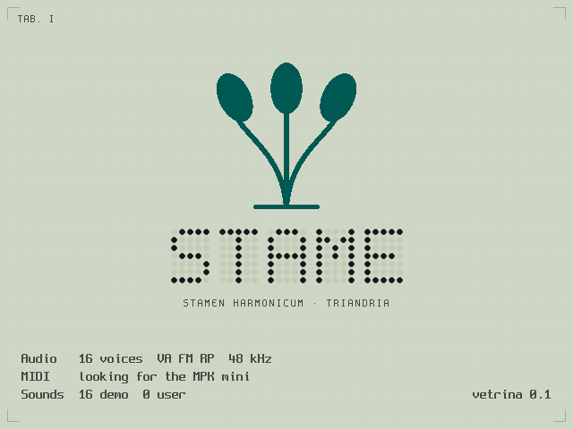

1. Sulla Flip: **App › Altro › Stame**. Per 2,6 secondi il vetrino mostra i tre stami che si accendono, con il logo sonoro, e le righe dell'inizializzazione.
2. Se non tocchi niente, **parte la demo** (i brani «Acacia», «Felce» e «Pistillo», a giro). Un tasto, un pad o una nota la fermano e lo strumento è tuo.
3. Per uscire: **MENU › Quit Stame** (esce subito, senza conferma). Uscita di sicurezza: **MENU tenuto 2 secondi**. Accensione e spegnimento della Flip e il volume di sistema restano a spruceOS.

Lo stato della MPK e del pad si vede nella testata, in alto: a riposo c'è solo la batteria; «NO MPK» lampeggia finché la tastiera non c'è; «PAD» in rosso vuol dire che il macro pad non si apre o manda codici sconosciuti (§10).

## 3. Suonare un accordo

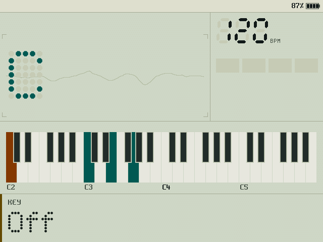

- **Pad = tipo ed estensione.** Fila in alto, da sinistra: **Dim, Min, Maj, Sus**. Fila in basso: **6, m7, M7, 9**. Tieni un tipo e premi un tasto: suona l'accordo con quella fondamentale. Un'estensione aggiunge sempre lo stesso intervallo (il 6 non diventa 13; la 9 è la seconda, dentro la finestra). Dim + m7 dà il semidiminuito.
- **Tasti = fondamentale.** Conta solo il nome della nota: l'ottava del tasto e OCT−/OCT+ della MPK non cambiano nulla, perché il registro lo decide il **Chord Voicing**. La tastiera è monofonica: un tasto nuovo sostituisce il precedente. Un tasto senza tipo, con la Key mode spenta, suona una **nota singola**.
- **Chord Voicing (manopola grande M del pad).** Tutte le note dell'accordo cadono in una finestra di un'ottava che parte dalla nota d'inizio: girando in su la nota più bassa sale di un'ottava, in giù la più alta scende; dodici scatti = la stessa voicing un'ottava sopra. Il valore va da 1 a 60 (la banda mostra «VOICING 032 C♯3»). Mentre giri, se l'accordo sta suonando si riattacca.
- **Bass Voicing (m1).** L'ottava del basso, 0…48. Il basso è sempre la fondamentale.
- **Premere M: Split ↔ Octave** per le note singole. In **Octave** i 12 tasti suonano l'ottava che contiene la nota d'inizio; in **Split** la finestra vale anche per le note singole, e il punto di divisione si sposta con il voicing.
- **Key mode (K4 / T4).** Premere Key accende o spegne la tonalità: con la Key mode accesa un tasto senza tipo suona l'accordo del suo grado (Do in Fa♯ minore dà il suo accordo) e la testata della zona accordo scrive la tonalità. Girare Key sceglie la tonalità fra le 42 (e accende la Key mode se era spenta). **Premere e girare Key = Transpose**, ±12 semitoni, su tutta l'uscita, loop compreso. Previsto: Key tenuto + tasto per la scelta rapida (con Min tenuto per la minore).
- **Play Style (Options).** **Simple**: suona ciò che tieni. **Advanced**: l'accordo resta anche se lasci il tipo; le estensioni si aggiungono a quello che suona. **Free**: come Advanced, e l'accordo si può cambiare o riattaccare più volte con il tasto tenuto.
- **Secret Chords (Options):** combinazioni di più tipi tenuti insieme che danno accordi nascosti. Con la voce spenta vale l'ultimo tipo premuto.

## 4. I controlli, uno per uno

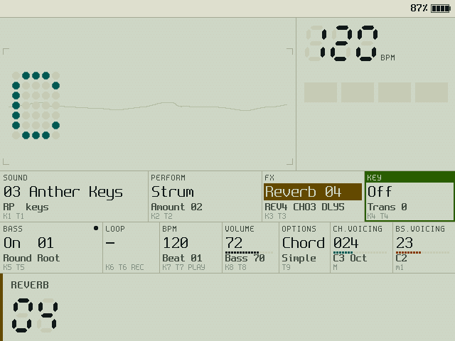

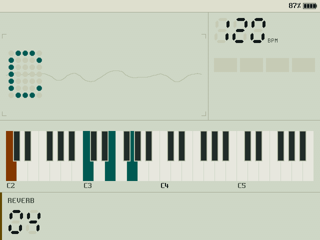

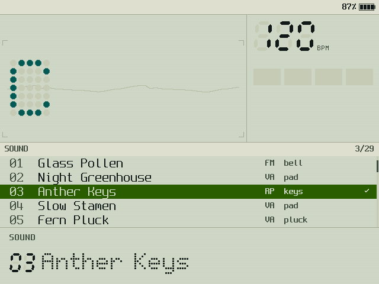

L'Orchid ha nove encoder che si girano e si premono e due manopole di voicing. Su Stame il **girare** sta sulle manopole K1…K8 della MPK (senza scatti) e il **premere** sui tasti T1…T9 del macro pad (o, in riserva, sui pad del banco B della MPK e su SHIFT come PUSH). Le quattro manopole con scatti e pressione (M, m1, m2 del pad e quella di navigazione della MPK) fanno tutti i gesti con una mano sola. I gesti sono quattro:

| Gesto | Come si fa |
|---|---|
| **premi** | un tocco (vale al rilascio, così si distingue dal premi-e-gira) |
| **tieni** | premuto per 1 secondo; scatta alla soglia |
| **premi e gira** | tieni Tn e giri Kn (stessa posizione nella griglia), oppure premi e giri una manopola del pad |
| **gira** | la manopola |

Dove stanno: K1 Sound, K2 Perform, K3 FX, K4 Key / K5 Bass, K6 Loop, K7 BPM, K8 Volume sulla MPK; T1…T8 gli stessi, in griglia gemella, sul pad; T9 Options; M Chord Voicing; m1 Bass Voicing; m2 liste e fuoco (vedi §7 per il Lock, che cambia il mestiere di M, m1, m2). Premere un tasto Tn porta anche il **fuoco** su quel controllo: da lì la croce e A della Flip, o la manopola di navigazione della MPK, lo girano e lo premono.

| Controllo | Gira | Premi | Tieni 1 s | Premi e gira |
|---|---|---|---|---|
| **Sound** | i 29 suoni: 16 di sintesi (Glass Pollen, Night Greenhouse, Anther Keys, Slow Stamen, Fern Pluck, Copper Reed, Orbit Choir, Moss Strings, Dew Mallet, Tape Fern, Seed Organ, Sun Room, Linnaeus Lead, Petal Brass, Root Drone, Vetro Pad) e 13 campionati (Grand Piano, Upright Piano, FM Piano, Vibraphone, Marimba, Glockenspiel, Tubular Bells, Concert Harp, Kalimba, Harpsichord, Pipe Organ, Alto Recorder, Tenor Sax); ogni suono porta il suo Perform | lista dei suoni per nome | previsto: Save / Save As / Delete | — |
| **Perform** | la quantità del modo: Strum, Strum 2 Oct, Slop e Harp 1…10; Arpeggiate e Arp 2 Oct il tipo 1…6; Pattern il numero 1…13; 0 = spento | lista dei modi | **Lock**: il Perform non cambia più al cambio di suono (la cella mostra LOCK) | — |
| **FX** | intensità 0…10 dell'effetto principale del suono (REVERB, CHORUS, ENSEMBLE, PHASER, FLANGER, DRIVE, TREMOLO, DELAY) | mostra l'effetto | **Lock** dell'effetto | — |
| **Key** | la tonalità (accende la Key mode) | Key mode on/off | previsto: scelta rapida | **Transpose** ±12 |
| **Bass** | i 6 bassi (Round Root, Sub Floor, Pluck Bass, Reed Bass, Velvet Sub, Wood Bass) | basso on/off | previsto: lista dei modi | — |
| **Loop** | con il loop in corso sceglie fra le tre voci in Z3 (OVERDUB, PAUSE, CLEAR o UNDO; STOP, PLAY…) | da fermo **REC**; altrimenti esegue la voce scelta | previsto: 2 s = Save Loop / uscita morbida | — |
| **BPM** | 60…200 | Beat o metronomo on/off | lista: **2/4, 3/4, 4/4, 6/8** (metronomo) e i 12 Beat **Funk, Bossa, Motorik, Lounge, Shuffle, Halftime, Boom Bap, Disco, Samba, Ballad, Train, Chip**, ognuno con il suo kit (studio, jazz, 808; Chip è la sintesi) | **Beat Volume** 0…99 |
| **Volume** | volume master 0…99 | batteria della Flip | — | **Bass Volume** 0…99 |
| **Options** | cambia la vista (fuori dalla lista) | lista: Exit, View, Play Style, Single Notes, Secret Chords | — | — |
| **Chord Voicing** (M) | finestra ±1 semitono per scatto | Split ↔ Octave | — | — |
| **Bass Voicing** (m1) | ottava del basso | il modificatore **Mod**: Mod + BPM = batteria a tastiera (i 12 tasti suonano il kit del Beat e i colpi entrano nel loop quantizzati al sedicesimo; sulla plancia «DRUMS» e le sigle sui tasti C4…B4), Mod + Loop = uscita forzata dal loop (Clear); Mod + Bass = basso on/off, come Bass da solo | — | — |

Liste: la voce in cima è Exit; la croce o la manopola di navigazione scorrono, A o la pressione scelgono, B chiude. Una lista si chiude da sola dopo 10 secondi, e si chiude anche toccando un altro controllo. Ogni controllo toccato accende la **banda** in fondo allo schermo con il suo nome e valore in grande: è l'overlay dell'Orchid, che qui non copre l'accordo.

## 5. Il looper, passo per passo

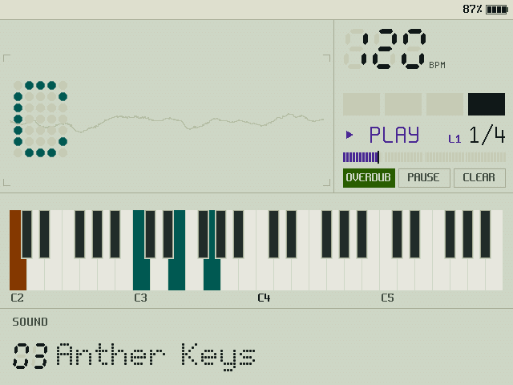

Il looper registra **eventi** (note), non audio: cambiando BPM cambia la velocità del loop, cambiando suono cambia il suono del loop, il transpose vale anche per il loop.

1. **Registrare.** Premi Loop (T6, oppure **REC** della MPK). Il metronomo conta **una battuta** («04» … «01» sulla banda) e poi registra **4 battute**; le note suonate un attimo prima del via entrano a tempo. Finite le 4 battute il loop suona da solo e il pannello in alto a destra mostra ▶ PLAY, la battuta («2/4») e il giro. Durante il count-in e la registrazione la cornice del pannello è rossa.
2. **Sovraincidere.** Con il loop che suona: Loop girato fino a OVERDUB e premuto, oppure **⊕** della MPK. Suona sopra: tutto quello che fai entra in un nuovo strato, giro dopo giro. Per chiudere lo strato: ancora ⊕ (o la voce STOP).
3. **Pausa e ripresa.** **LOOP** della MPK mette in pausa (le note si spengono); di nuovo LOOP riparte da capo, con il trasporto, così Beat e loop restano allineati.
4. **Undo.** **UNDO** della MPK, o la voce UNDO, toglie l'ultimo strato; con il solo primo strato diventa Clear.
5. **Cancellare.** La voce CLEAR, oppure **SHIFT + UNDO** sulla MPK: via tutto, il looper torna fermo.
6. Previsti: Waiting Room con la scelta delle battute (Free, 1, 2, 4, 8, 16), salvataggio in 10 slot, uscita morbida (Loop tenuto 2 s) e uscita forzata (Mod + Loop).

## 6. Beat e metronomo

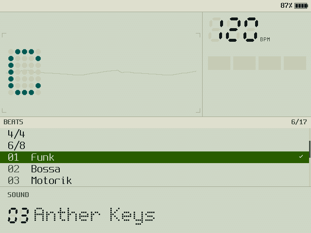

- **BPM premuto** (T7, oppure **STOP/PLAY** della MPK) accende e spegne il Beat scelto; con un metronomo scelto, accende il clic. Il trasporto riparte dalla battuta 1.
- **BPM tenuto** apre la lista: le quattro metriche (2/4, 3/4, 4/4, 6/8) scelgono il metronomo; sotto, i sei Beat. La spunta segna la scelta.
- **BPM premuto e girato** regola il volume del Beat.
- Con il looper in moto, spegnere il Beat lo zittisce soltanto: il tempo del loop continua.
- In alto a destra: i battiti della battuta come celle che si accendono, il BPM a sette segmenti.

### 6.1 Loop di batteria dalla tastiera

Lo stesso principio degli accordi, per la batteria: **Mod + BPM** (m1 premuta e T7, oppure Y + START sulla Flip) accende la **batteria a tastiera**. I 12 tasti suonano il kit del Beat scelto: Do cassa, Do♯ rimshot, Re rullante, Re♯ battimani, Mi charleston chiuso, Fa tom basso, Fa♯ charleston aperto, Sol tom alto, Sol♯ maracas, La conga, La♯ campanaccio, Si piatto. Se il looper registra o sovraincide, ogni colpo entra nel loop **quantizzato al sedicesimo**, come le note. Pad, basso e Perform restano fermi; un altro Mod + BPM torna agli accordi. Sulla plancia: «DRUMS» nella zona accordo e le sigle sui tasti C4…B4, che si accendono al colpo.

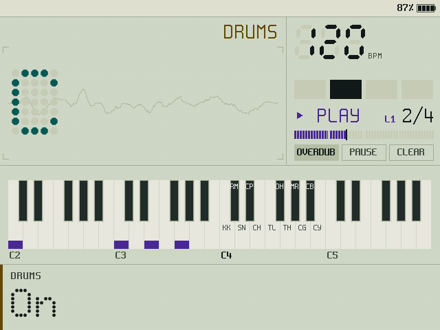

## 7. Il macro pad

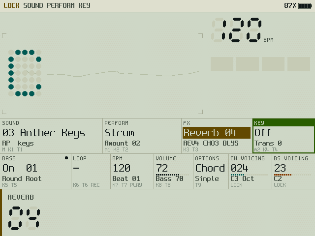

Quindici tasti in tre file da cinque e tre manopole a scatti. Le prime quattro colonne sono la **griglia gemella** delle manopole della MPK:

| | col. 1 | col. 2 | col. 3 | col. 4 | col. 5 |
|---|---|---|---|---|---|
| in alto | **T1** Sound | **T2** Perform | **T3** FX | **T4** Key | **T13 LOCK** |
| in mezzo | **T5** Bass | **T6** Loop | **T7** BPM | **T8** Volume | **T14 VIEW** |
| in basso | **T9** Options | **T10** Back | **T11** Menu | **T12** Panic (tenuto 1 s) | **T15 PAGE** |

- Tn **premuto** = premere l'encoder; Tn **tenuto** = tenerlo; **Tn tenuto + Kn girata** = premere e girare (T4 + K4 = transpose, T8 + K8 = volume del basso, T7 + K7 = volume del Beat).
- **T12 Panic** scatta solo dopo 1 secondo: spegne tutte le note. Sulla MPK: **SHIFT + STOP/PLAY**.
- **T13 LOCK, a scatto come il Caps Lock.** Un tocco accende, un altro spegne; non si tiene. Le manopole della MPK non hanno scatti, quelle del pad sì: con il Lock acceso le tre manopole del pad diventano gli encoder che hanno bisogno degli scatti, con tutti i loro gesti.

| Manopola | Lock spento | Lock acceso |
|---|---|---|
| **M** (grande) | Chord Voicing · premi = Split/Octave | **Sound** · premi = lista · tieni = previsto Save |
| **m1** | Bass Voicing · premi = Mod | **Perform** · premi = lista dei modi · tieni = Lock del Perform |
| **m2** | liste e fuoco · premi = conferma | **Key** · premi = Key mode · premi e gira = Transpose |

  Finché è acceso la testata mostra **LOCK SOUND PERFORM KEY**; nella pagina dei comandi le celle dicono quale manopola fa cosa. Liste, fuoco e conferma restano sulla manopola di navigazione della MPK e sulla croce e A della Flip. Se stacchi il pad, il Lock si spegne.
- **T14 VIEW**: Geek Out e, al tocco dopo, la vista di prima.
- **T15 PAGE**: apre la pagina dei comandi della Flip e la tiene aperta finché non lo ripremi (o premi B).
- Se il pad non c'è, i pad del **banco B** della MPK fanno da pulsanti di riserva (B1 Key, B2 Bass, B3 Perform, B4 Chord Voicing, B5 Loop, B6 BPM, B7 Options, B8 PUSH) e **SHIFT** tenuto fa da PUSH: tocca o gira una manopola K mentre lo tieni e quella manopola risulta «premuta».

## 8. La MPK mini IV

| Comando | Fa |
|---|---|
| 25 tasti | i 12 tasti dell'Orchid (conta solo il nome della nota) |
| pad, banco A | Dim Min Maj Sus (sopra) · 6 m7 M7 9 (sotto) |
| pad, banco B | i pulsanti di riserva (§7) |
| K1…K8 | girano Sound, Perform, FX, Key / Bass, Loop, BPM, Volume |
| SHIFT | PUSH: tenuto, la manopola K toccata è «premuta» |
| manopola di navigazione | gira = liste e fuoco; premi = conferma; premi e gira = premi-e-gira del controllo con il fuoco |
| − / + | Back / menu della piattaforma |
| UNDO | Undo del loop; **SHIFT + UNDO = Clear** |
| LOOP | pausa e ripresa del loop |
| STOP/PLAY | Beat on/off; **SHIFT + STOP/PLAY = Panic** |
| REC | Loop: registra, poi sovraincide |
| ⊕ | overdub: entra ed esce |
| ruote | pitch bend e modulazione del suono |
| pedale | sustain |
| BANK A/B, OCT−/+, ARP, LATCH, NOTE REPEAT, TAP, PLUGIN/DAW | interni della MPK: Stame li ignora. Attenzione: SHIFT insieme a un pad cambia i modi interni della MPK; se succede, torna al preset DAW |

## 9. La Flip

### 9.1 Lo schermo

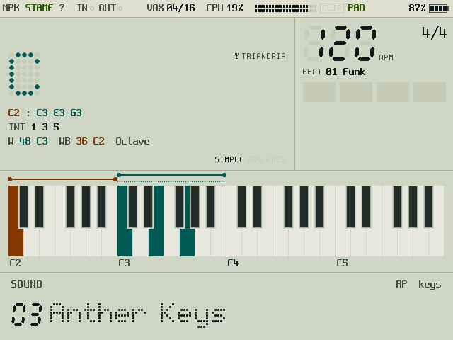

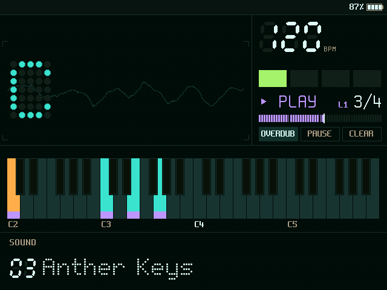

Il vetrino mostra, dall'alto: la **testata** (batteria; avvisi solo quando servono; LOCK), la **zona accordo** (tonalità e transpose, il nome dell'accordo in grande), la **zona tempo e loop** (BPM, battiti, il looper quando lavora), la **tastiera** a quattro ottave (treble in acqua, basso in ambra, loop in viola, i granelli della tonalità) e in fondo la **banda**, che mostra in grande il controllo appena toccato e, a riposo, il suono.

Due pagine:
- **pagina di gioco**: quello che serve mentre si suona;
- **pagina dei comandi**: al posto della tastiera, le 11 celle dei controlli con valore, fuoco e la sigla del comando. Si apre con i tasti del fuoco della Flip (L1, R1, croce, A, X) e si chiude da sola 5 secondi dopo l'ultimo, o con B; con **T15** del pad si apre e resta aperta.

Sei **viste** per la zona accordo (Options › View, o **T14**): **React**, **Chord** (quella di fabbrica), **Keyboard**, **Chord+Kb**, **Notes** (le note scritte), **Geek Out** (note, intervalli, finestre, cartellino di Linneo, attività MIDI, voci, carico, livelli: la barra completa in testata).

Due **temi** (MENU › Theme): **Notte** (vetro scuro e fosfori, quello di fabbrica) e **Giorno** (LCD riflettente).

### 9.2 I tasti

| Tasto | Fa |
|---|---|
| L1 / R1 | sposta il fuoco fra gli 11 controlli (Sound, Perform, FX, Key, Bass, Loop, BPM, Volume, Options, Chord Voicing, Bass Voicing) e apre la pagina dei comandi |
| croce | gira il controllo con il fuoco, o scorre la lista aperta (con ripetizione se tenuta) |
| A | preme il controllo con il fuoco: conferma; tenuto = tieni; A tenuto + croce = premi e gira |
| B | indietro: chiude liste, overlay e pagina dei comandi |
| X | PUSH, come SHIFT della MPK (riserva) |
| Y | Bass Voicing premuto: il modificatore Mod (riserva) |
| SELECT | Options |
| START | BPM: Beat on/off |
| MENU | il menu della piattaforma; tenuto 2 s esce da Stame |

### 9.3 Il menu della piattaforma (MENU, o T11, o + della MPK)

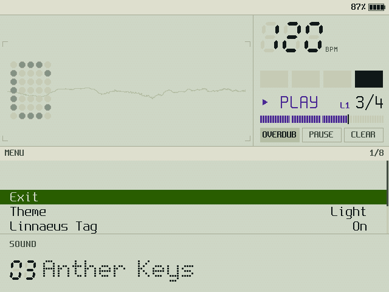

| Voce | Fa |
|---|---|
| Exit | chiude il menu |
| Theme | Dark / Light |
| Linnaeus Tag | On / Off: il cartellino con la classe dell'accordo (TRIANDRIA, TETRANDRIA…) in Geek Out |
| Legend | On / Off: le sigle dei comandi nelle celle della pagina dei comandi |
| Meters | On / Off: voci, carico e livelli nella barra di Geek Out |
| Demo | Auto / Off: la demo dopo 20 secondi senza ingressi |
| Play Demo Song | il brano successivo della demo, subito |
| Quit Stame | esce (subito) |

Previsti: Panic nel menu, Pocket Mode (suonare con la sola Flip), MPK Status, Learn Pad, Note Labels, Beat Flash, Ghost Chord, Boot Sound, Debug.

## 10. La demo

Sono tre brani originali di Stame, suonati a giro: **«Acacia»** (poco meno di quattro minuti: accordi in Harp, lista dei Beat, count-in e registrazione del loop, overdub, Lock del Perform, transpose, cambi di suono e di vista, i due temi, il ritardando), **«Felce»** (una bossa con piano a coda, vibrafono, kalimba in overdub, sax tenore, arpa e glockenspiel) e **«Pistillo»** (Boom Bap con la 808, poi Disco: FM piano, marimba, organo a canne nel loop, flauto dolce, campane tubolari). La demo parte da sola dopo 20 secondi senza ingressi (e subito dopo l'avvio). Qualunque tasto, pad o nota la ferma e rimette a posto loop, Beat, transpose e opzioni. Per non farla partire: MENU › Demo › Off. Per sentire il brano dopo: MENU › Play Demo Song.

## 11. Cosa fare se

| Vedi | Vuol dire | Fai |
|---|---|---|
| **NO MPK** lampeggia in testata | la tastiera non è collegata o non è riconosciuta | controlla cavo e hub (porta di sopra, hub senza Power Delivery); la MPK si riconosce dal nome «MPK mini IV» |
| **MPK FACTORY** | con la Plus: non è attivo il programma STAME | con la MPK mini IV non compare: basta il preset DAW |
| **PAD** in rosso | il macro pad non si apre in esclusiva, o manda codici che nessuna mappa conosce | ricollega il pad; usa lo strato 3 (o rendi l'1 uguale al 3). Previsto: MENU › Learn Pad |
| «Pad disconnected» | il pad si è staccato: i tasti tenuti si rilasciano, il Lock si spegne | ricollegalo |
| **CLIP** in testata | l'uscita satura | abbassa Volume, o il volume del basso o del Beat |
| **XRUN** | l'audio ha perso un periodo (crepitii) | in `launch.sh` porta `STAME_AUDIO_FRAMES` a 1024 |
| una nota resta appesa | — | Panic: T12 tenuto 1 s, oppure SHIFT + STOP/PLAY |
| Stame non risponde | — | MENU tenuto 2 s |

## 12. Glossario

- **Accordo a blocco**: tutte le note insieme, senza performance.
- **Banda**: la striscia in fondo allo schermo, che risponde al controllo toccato.
- **Beat**: una battuta di batteria in loop, scelta dalla lista di BPM.
- **Count-in**: la battuta di metronomo prima della registrazione.
- **Finestra**: l'ottava in cui cadono le note dell'accordo, decisa dal Chord Voicing.
- **Fuoco**: il controllo su cui agiscono croce e A della Flip e la manopola di navigazione; lo spostano L1/R1 e la pressione di qualunque encoder.
- **Griglia gemella**: K1…K8 della MPK e T1…T8 del pad nelle stesse posizioni: la manopola gira, il tasto preme.
- **Key mode**: la tonalità accesa: i tasti suonano i gradi.
- **Lock (Perform, FX)**: il valore non cambia al cambio di suono.
- **LOCK (T13)**: le manopole del pad fanno Sound, Perform e Key.
- **Mod**: Bass Voicing premuto (m1 o Y), il modificatore delle combinazioni (previste).
- **Overlay**: il nome e il valore del controllo toccato, nella banda.
- **PUSH**: SHIFT, B8 o X tenuti: la manopola K toccata risulta premuta.
- **Split / Octave**: come si distribuiscono le note singole sui 12 tasti.
- **Strato**: ogni passata di overdub nel loop.
- **Voicing**: la disposizione delle note nella finestra.
