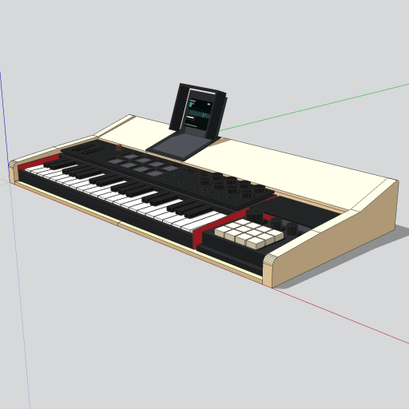

# Case di Stame — la console

Bozza 2, 14/10/2026. Specifica: `docs/specifica/60-case.md`. Identità: `docs/identita/README.md`.

Un telaio di betulla tiene insieme la MPK mini Plus, il macro pad BRIMFORD e la Miyoo Flip. Nessun apparecchio viene modificato (CASE-001): si posano e si tolgono in un minuto.



## Come si generano i pezzi

```
python -I hardware/case/genera.py
```

Tutte le misure stanno in `misure.py`, ognuna con la sua fonte: [M] manuale, [D] dedotto, [V] da verificare. Cambiata una misura, si rigenera tutto. Il generatore stampa l'elenco dei pezzi e controlla che stiano nei piani delle macchine e che i pezzi stampati siano gusci chiusi.

Escono in `hardware/case/out/`:
- **SVG per il laser**, in scala 1:1 e in millimetri. In LightBurn il rosso è taglio, il nero pieno è incisione, il blu è un segno leggero (posizioni, aree);
- **STL da stampare**;
- `dima_mascherina.svg`, da stampare su carta al 100%;
- `tavola_insieme.svg`, vista dall'alto e di fianco (non si taglia);
- `stame_console.skp`, il modello 3D (costruito con SketchUp a partire dalle stesse misure).

## Prima di tagliare

1. **Misurare** con il calibro le voci [V] di `misure.py`, soprattutto:
   - posizione e misura dei controlli della MPK (`MPK_CTRL`, `FORO`);
   - altezza dei pulsanti piccoli della MPK: la mascherina sta 4 mm sopra (`piede_h`);
   - ingombro del macro pad e posizione di tasti e manopole;
   - porte, tasti del volume e cerniera della Flip.
2. **Stampare la dima** su carta al 100% e controllare il righello di 100 mm. Ritagliarla e posarla sulla MPK: i fori devono cadere sui controlli, i cerchi blu dei piedini su zone piane senza pulsanti.
3. **Prova di taglio** di un ritaglio di acrilico e di compensato per tarare potenza, velocità e passate (il laser a diodo taglia l'acrilico nero, non quello trasparente).

## Pezzi

### Laser

| File | Materiale | Quanti | Note |
|---|---|---|---|
| `mascherina_sx.svg`, `mascherina_dx.svg` | acrilico nero 3 mm | 1 + 1 | incisione chiara: le legende; si può ripassare con colore sabbia |
| `cartellino_pad.svg` | acrilico nero 3 mm | 1 | legenda del macro pad, copre il vano dell'hub |
| `ponte_sopra_sx.svg`, `ponte_sopra_dx.svg` | betulla 4 mm | 1 + 1 | tasca della Flip, marchio, legende dei tasti della Flip, griglia |
| `ponte_fronte_sx.svg`, `ponte_fronte_dx.svg` | betulla 4 mm | 1 + 1 | la metà destra ha la bocca per i connettori della MPK |
| `ponte_retro_sx.svg`, `ponte_retro_dx.svg` | betulla 4 mm | 1 + 1 | uscite dei cavi |
| `centine.svg` | betulla 4 mm | 3 (in un file) | reggono il piano del ponte |
| `fianco_sx_esterno.svg`, `fianco_dx_esterno.svg` | betulla 4 mm | 1 + 1 | strato esterno con marchio e nome |
| `fianco_interno.svg` | betulla 4 mm | 6 | tre strati interni per fianco, incollati all'esterno: 16 mm |
| `base_sx.svg`, `base_dx.svg` | betulla 6 mm | 1 + 1 | si incastrano a coda di rondine |
| `divisorio.svg` | betulla 4 mm | 1 | fra MPK e macro pad, copre la guancia rossa |

### Stampa 3D (Kobra S1, PETG)

| File | Quanti | Note |
|---|---|---|
| `culla_flip.stl` | 1 | scende nella tasca del ponte; dietro e ai lati è aperta per porte e tasti del volume [V] |
| `visiera.stl` | 1 | cappa attorno allo schermo aperto; si avvita al ponte |
| `vassoio_pad.stl` | 1 | solleva il macro pad all'altezza della mascherina [V] |
| `piedino_mascherina.stl` | 14 | meglio in TPU; si incollano sotto la mascherina dove indica la dima |
| `squadretta_m3.stl` | 12 | uniscono base, fianchi, ponte e divisorio |
| `fermo_hub.stl` | 1 | tiene l'hub USB nel vano sotto il cartellino |
| `colonnina.stl` | 4 | reggono il cartellino sopra l'hub |

Minuteria: viti M3×8 per legno o autofilettanti (fori da 2,5 mm nel compensato), colla vinilica per i fianchi a strati, piedini in gomma da 12 mm sotto la base.

## Montaggio

1. Incollare i fianchi: tre strati interni e l'esterno, allineati sul profilo.
2. Unire le due metà della base (coda di rondine e colla).
3. Ponte: fronte, retro e centine sulla base con le squadrette; poi il piano, incollato sulle centine.
4. Fianchi e divisorio sulla base con le squadrette.
5. Culla della Flip nella tasca, visiera dietro la culla, hub nel suo fermo, cartellino sulle colonnine.
6. MPK nel suo vano, mascherina sopra con i piedini, macro pad nel vassoio.

## Misure principali

| | mm |
|---|---|
| ingombro | 619 × 288 |
| altezza del ponte | 52 davanti, 78 dietro (15°) |
| altezza con lo schermo aperto | 150 |
| lo schermo sporge dietro la base | 21 |
