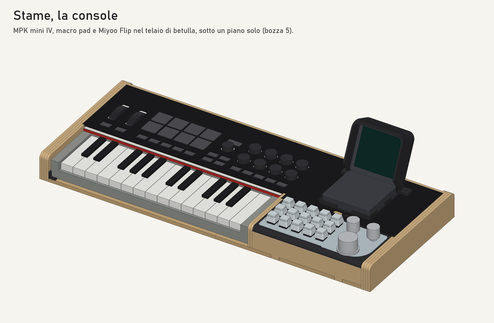
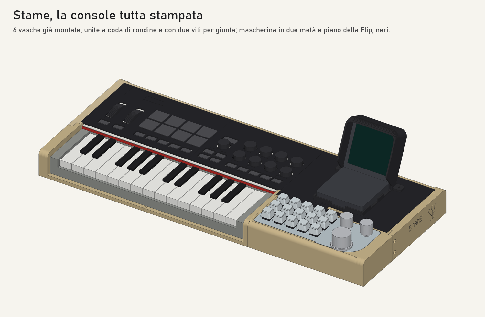
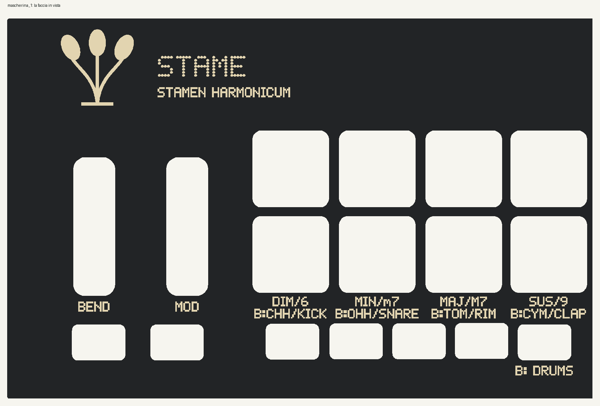

# Case di Stame — la console

Bozza 5, 18/10/2026. Specifica: `docs/specifica/60-case.md`. Identità: `docs/identita/README.md`.



Un telaio di betulla tiene insieme la MPK mini IV, il macro pad BRIMFORD e la Miyoo Flip, nella composizione scelta da Luigi: MK4 a sinistra; a destra il pad davanti, in linea con i tasti, e la Flip aperta dietro. Nessun apparecchio viene modificato (CASE-001): si posano e si tolgono in un minuto.

Cosa cambia nella bozza 5 (Luigi, 18/10/2026: «deve essere tutto coperto e omogeneo. non mi piace tanto la divisione che hai creato tra mpk e pad, e per il pad vorrei una culla simile a quella che hai fatto per il flip»):
- **Un piano solo.** Fianchi, retro e costola arrivano tutti a 45 mm; davanti al pad la parete si ferma dove comincia la curva dei fianchi, e sopra la continua il bordo della culla. Dentro c'è un piano di acrilico nero da 2 mm in due pezzi, alla stessa quota: la mascherina a sinistra e il piano della Flip a destra. Hub e cavi stanno sotto, coperti; non ci sono più la torre, la mensola e il divisorio.
- **La mascherina appoggia sulla MK4** e ha un foro per ogni controllo, anche per quelli che Stame non usa (Luigi: «falla che si poggia bene con i fori anche per i controlli non utilizzati»). Sui controlli di Stame ci sono le sue legende; su quelli della MK4 stessa (OCT, ARP, LATCH, NOTE REPEAT, TAP, BANK, DAW) il loro nome, piccolo. Dietro copre la zona dei cavi fino al retro, con la targa di Stame.
- **La culla del pad** tiene il corpo del pad, con la piastra a filo del piano e niente bordo sopra (Luigi, 19/10/2026: «tutto a pari»). Dentro segue il contorno vero del pad, misurato sulle foto di Luigi del 18/10/2026 e con il metro il 19/10/2026: il lobo davanti dal lato delle manopole, gli angoli, la USB-C e l'interruttore sul retro. Sta in piedi sulla base, poggia il pad su sei costole e regge con un dente il bordo del piano della Flip. Dietro ha la finestra per la spina del pad, che resta sotto il piano.
- **Gli appoggi.** Lo strato più interno di fianchi, retro e costola è più basso dove sopra c'è il piano: con una striscia di feltro da 1 mm, il piano ci appoggia alla quota della MK4.
- **Il cartellino non c'è più**: i tasti del pad hanno le etichette sotto il coperchio, e le manopole del pad hanno la loro legenda sul piano, fra le due culle.

Rivisto da Luigi sul modello il 19/10/2026: MK4, pad e hub rimisurati con il metro; acrilico da 2 mm; console profonda 240, che così sta intera nel piatto della Kobra S1; il retro arretrato fra i fianchi fin dove finisce la loro curva; una colonnina sotto il piano della Flip; la **visiera** stondata, che copre i fianchi e il dorso del coperchio aperto, così il bianco del coperchio non si vede.

## Come si genera tutto

```
python -I hardware/case/genera.py      pezzi (SVG laser, STL), fogli di taglio (SVG, DXF), dima, tavola
python -I hardware/case/assieme.py     modello 3D (OBJ), dati per SketchUp, tavole del montaggio (PNG)
python -I hardware/case/stampa3d.py    la console tutta stampata a vasche, per chi non ha il laser (out/stampa3d/)
python -I hardware/case/multicolore.py la stessa, per stampanti a più filamenti: le scritte le fa la stampa (out/stampa3d_multicolore/)
                                       (--nes nei colori del NES, con i tre PETG di Luigi: out/stampa3d_nes/)
python -I hardware/case/progetto.py    il lavoro per Anycubic Slicer Next, Kobra S1: stampa3d_nes/stame_kobra_s1.3mf
python -I hardware/case/manuale.py     PDF: progetti di taglio, istruzioni di montaggio, istruzioni della versione stampata
                                       (--stampa3d solo le due console stampate)
python -I hardware/case/sketchup.py    codice per costruire il modello in SketchUp (out/sketchup/)
python -I hardware/case/etichette.py   etichette dei tasti trasparenti del pad (A4, SVG e PDF)
python -I hardware/case/rendering.py   rendering con Blender 5.2, Cycles sulla CPU, dieci viste (out/render/)
                                       (--stampata la console stampata nei PETG di Luigi, otto viste)
```

Attenzione: il 18/10/2026, su HOMEPC, `rendering.py` in qualità piena con Cycles sulla GPU (OptiX) ha mandato il PC in schermata blu due volte (0xEF). Dal 19/10/2026 Cycles lavora sulla CPU, e i rendering in `out/render/` sono stati rifatti così sul PC di lavoro (circa un'ora e mezza per le dieci viste); su HOMEPC non si rilancia senza l'ok di Luigi.

Tutte le misure stanno in `misure.py`, ognuna con la sua fonte: [M] manuale, [O] osservato, [D] dedotto, [V] da verificare. Cambiata una misura, si rigenera tutto. `genera.py` controlla che i pezzi stiano nei piani delle macchine, che i pezzi stampati siano gusci chiusi e che le scritte incise non escano a specchio.

Il riferimento del case (x a destra, y verso il musicista, z in su) è sinistrorso. Gli STL e i modelli 3D escono specchiati su y, cioè nel verso fisico giusto: senza lo specchio la culla avrebbe gli intagli dal lato sbagliato.

`manuale.py` usa la suite ArtCraft: VectorCraft converte le pagine SVG in PDF vettoriali, PdfCraft le unisce. Il modello SketchUp si costruisce con lo strumento SketchUp (nel cloud), eseguendo nell'ordine i file `out/sketchup/parte_N.py` (da 0 in su) e `scene.py`, poi salvandolo. Ha un livello e una scena per ogni passo del montaggio.

`rendering.py` prepara le texture in `build/render/` (incisioni dagli SVG, etichette, la faccia della Flip raddrizzata dalla foto o, se la foto manca, disegnata, la plancia sullo schermo nei temi Giorno e Notte) e lancia `blender_scena.py` in Blender: betulla con i bordi bruciati dal laser, acrilico nero satinato con le incisioni, PETG con gli strati, alluminio, tasti trasparenti con l'etichetta dentro, la MK4 con le guance grigie e il bordo rosso del pannello, il pad a strati, l'hub. Il fondale da studio è curvo e gira con la camera. Le viste: eroe, pad, mascherina, frontale, alto, retro, fianco, schermo, esploso (i pezzi nell'ordine del montaggio) e sera (tema Notte, fondale scuro). La luce da studio è `studio_small_09_2k.hdr` di Poly Haven (CC0), da scaricare in `build/render/studio.hdr`. `--prova` fa una passata veloce (tre minuti per tutte), `--viste eroe,pad` solo quelle. `--stampata` fa la console tutta stampata a più colori (le tre vasche di `multicolore.py`) nei tre PETG Anycubic di Luigi, con un richiamo al NES europeo (20/10/2026): vasche crema con la fascia grigia fino a 8 mm (un cambio di filamento a quello strato), piani, culla della Flip e visiera in grigio traslucido, scritte rosse (`FILAMENTI` in `blender_scena.py`); otto viste, in `out/render/stampata_*.jpg`. `tools/sito_case.py` porta render, tavole e fogli nel sito (`docs/case.html`).

## Cosa esce in `out/`

| File | Cos'è |
|---|---|
| `istruzioni_montaggio.pdf` | copertina con pezzi e minuteria, un passo per pagina, misure da verificare |
| `taglio/progetti_di_taglio.pdf` | i fogli 1:1 per materiale e la dima |
| `taglio/taglio_*.svg`, `.dxf` | i fogli per LightBurn: rosso taglio, nero incisione, blu segno (nel DXF: livelli TAGLIO, INCISIONE, SEGNO) |
| `*.svg` | i singoli pezzi del laser, 1:1 in millimetri |
| `*.stl` | i pezzi da stampare, nel verso giusto, appoggiati sul piatto |
| `stame_console.skp` | il modello SketchUp, con le scene dei passi |
| `stame_console.obj`, `.mtl` | lo stesso modello per altri programmi, in millimetri |
| `montaggio/*.png` | le tavole dei passi e due viste della console |
| `render/*.jpg` | i dieci rendering della console laser e gli otto della stampata, `stampata_*.jpg` (vedi sopra) |
| `etichette_pad.pdf`, `.svg` | le etichette dei tasti del pad, A4 al 100 % |
| `dima_mascherina.svg`, `tavola_insieme.svg` | dima da stampare su carta, tavola dall'alto e di fianco |
| `stampa3d/` | la console tutta stampata: vedi sotto |

## Senza laser: la console tutta stampata



Per chi non ha il laser c'è la stessa console fatta solo con una stampante 3D (`docs/specifica/60-case.md` §7b). Dal 19/10/2026 non ricopia più i pezzi del laser (Luigi: «sono sicuro che si possa ridurre il numero di pezzi e stampare più parti già assemblate in un unico modello»): `stampa3d.py` la fa **a vasche**.
- **Una vasca è un tratto di console già montato**, stampato in piedi con il fondo sul piatto: il fondo, il fianco con il suo profilo, il retro con le finestre, la costola con il passaggio dei cavi, la parete davanti, gli appoggi del piano alla quota del feltro; nella vasca di destra anche il fermo dell'hub, la colonnina e la culla del pad. Niente squadrette, linguette o strati da incollare. Le sagome e le sedi sono quelle di `misure.py` e `genera.py`; il fondo è da 3 mm, pieno fino a 6 sotto la MK4, dietro il retro e lungo le giunte.
- **Quante:** tre colonne, con una giunta a metà sotto la MK4 e una fra la costola e la culla del pad, che resta intera. Con un piatto da 240 (la Kobra S1: la console è profonda 240) ogni colonna è una vasca intera davanti-dietro; con un piatto più piccolo, da 208 in su, le colonne si dividono anche davanti-dietro, fra la colonnina e la culla: sei vasche.
- **Le giunte:** nel fondo code di rondine verticali, che si infilano dall'alto calando una vasca accanto all'altra e tengono le vasche allineate; le pareti che attraversano la giunta (il retro, e con sei vasche i fianchi e la costola) si sormontano a mezzo spessore per 12 mm, con due viti M3 a brugola e il dado nella sua sede, che le tengono insieme in altezza. Niente colla, e la console si smonta. `prova_giunta.stl` è la giunta sotto la MK4 in piccolo, da stampare prima.
- **Restano a parte** i pezzi che si tolgono per arrivare ai cavi: la mascherina, in due metà accostate (i fori sui comandi della MK4 tengono ogni metà al suo posto), e il piano della Flip; poi la culla della Flip e la visiera.
- **Le scritte:** sui fianchi il marchio e il nome sono in rilievo sulla faccia di fuori, che stampata in piedi è verticale. Sulla mascherina e sul piano della Flip le scritte del laser sono troppo fini per un ugello da 0,4: ogni gruppo ha una tasca profonda 0,4 mm, e le etichette si stampano su carta adesiva.

Il piatto di riferimento è 210 × 210 mm, cioè le stampanti da 220 in su: sei vasche; `--piatto 240` rigenera tutto con tre. In tutto servono circa 1 kg di PETG o PLA (stima a fette, come lo slicer): le vasche color legno o sabbia, i piani e le culle neri.

| File in `out/stampa3d/` | Cos'è |
|---|---|
| `istruzioni_stampa3d.pdf` | i pezzi con i grammi e le impostazioni, le vasche e le giunte, le scritte, il montaggio |
| `pezzi.md` | l'elenco dei pezzi con le misure, i grammi e le note, le giunte, le viti, il montaggio |
| `vasca_*.stl` | le vasche, in piedi con il fondo sul piatto |
| `mascherina_1.stl`, `_2.stl`, `piano_flip.stl` | i piani, con la faccia in vista in alto e le tasche delle etichette |
| `culla_flip.stl`, `visiera.stl` | la culla della Flip e la visiera, come in `genera.py` |
| `prova_giunta.stl` | le due metà di una giunta, da stampare prima delle vasche |
| `etichette_mascherina.pdf`, `.svg` | le etichette 1:1 da stampare al 100 % su carta adesiva, con la mappa delle tasche |
| `console_stampata.png`, `console_stampata_retro.png`, `vasche.png`, `giunta.png` | la console montata, davanti e dietro; le vasche staccate; la prova di giunta |

## A più colori: le scritte le fa la stampante



Per una stampante a più filamenti (Luigi ha una Anycubic Kobra S1 con l'ACE Pro) c'è una versione in più, accanto a quella qui sopra, che resta com'è (`docs/specifica/60-case.md` §7c). `multicolore.py` fa le stesse vasche per un piatto di 240 mm, cioè tre, intere davanti-dietro, e gli stessi pezzi che si tolgono, con le scritte stampate in un secondo colore, incassate a filo per 0,6 mm (tre strati).

- Mascherina e piano della Flip si stampano con la faccia in vista sul piatto: viene liscia, e il cambio di filamento serve solo nei primi tre strati.
- Nelle vasche di sinistra e di destra il marchio e il nome sono incassati nella faccia di fuori del fianco, che stampata in piedi è verticale: lì il filamento cambia in ogni strato fra il basso del marchio e la cima del nome, circa 126 strati per vasca (`pezzi.md` dice quanti). Chi non vuole i cambi stampa le vasche a un colore, con il marchio in rilievo.
- Le incisioni del laser sono troppo fini per un ugello da 0,4: le scritte sono ridisegnate con Matrice, il carattere 5×7 di Stame, a quadretti da 0,45 mm (lettere alte 3,15 mm). Fra le due file di pad della MK4 non c'è posto: i tipi d'accordo vanno sotto, con l'estensione della stessa colonna («DIM/6», «B:CHH/KICK»).
- Due filamenti: 1 nero, 2 sabbia. I piani sono neri con le scritte sabbia, le vasche color telaio con le scritte nere.
- Ogni pezzo con le scritte esce in un `.3mf` (un oggetto con le parti «corpo» e «scritte», i filamenti già assegnati) e in due STL allineati, `_corpo` e `_scritte`, da importare insieme come un oggetto solo. Gli altri pezzi sono STL di un colore.
- `pezzi.md` dice come caricarli in Anycubic Slicer Next; `anteprima_*.png` mostra ogni faccia come la si guarda; `istruzioni_multicolore.pdf` (tre pagine A4, `manuale.py --multicolore`) raccoglie pezzi, filamenti, slicer e anteprime da stampare.
- **Nei colori del NES** (Luigi, 20/10/2026: «mi fai una in modalità multicolor con i colori NES? cartella con i pezzi da stampare sulla mia kobra s1»): `multicolore.py --nes` scrive `out/stampa3d_nes/`, gli stessi pezzi per la Kobra S1 nei tre PETG Anycubic di Luigi, 1 grigio traslucido, 2 crema, 3 rosso. Piani, culla della Flip e visiera grigi, vasche crema, scritte rosse; le vasche hanno in più la fascia grigia dei primi 8 mm, sotto le scritte dei fianchi, che nel `.3mf` è una terza parte (`_fascia`) con il suo filamento: nello slicer non c'è niente da impostare. Come nei rendering `stampata_*.jpg`. `progetto.py` (lo rifà anche `multicolore.py --nes`) ne fa il lavoro per Anycubic Slicer Next: `stame_kobra_s1.3mf`, sei piatti con i pezzi già messi, la torre di spurgo, i tre filamenti e le impostazioni di `pezzi.md`; stampante e profilo vengono da un progetto salvato da Luigi (`kobra_s1.json`). Affettato dalla riga di comando dello slicer (2.0.0.3) il 20/10/2026: tutti e sei i piatti, circa 52 ore in modo normale, 641 g di grigio, 430 di crema e 41 di rosso, più lo spurgo.

## Prima di tagliare

1. **Misurare** le voci [V] di `misure.py`. I controlli della MK4 e le porte della Flip sono stati rimisurati sulle foto il 17/10/2026 (±1 mm); restano:
   - altezza del pannello della MK4 (37 mm, `MK4['h']`): la mascherina ci appoggia, e il piano della Flip va alla stessa quota;
   - altezza dei pulsanti piccoli della MK4: con la mascherina appoggiata stanno 1-2 mm sotto la sua faccia;
   - il macro pad è misurato con il metro il 19/10/2026: contorno 185 × 75, corpo 16,2 (`PAD_CORPO`, le foto del 18/10 davano 11,5), presa USB-C sul retro fra m1 e m2 a 148 mm dal bordo dei tasti e 8,3 sopra il fondo (`PAD_USB_Z`), interruttore a slitta a 78. Resta da vedere a che altezza sta l'interruttore: la finestra della culla va dal fondo fin sopra la spina;
   - angolo di apertura della Flip (serve almeno 115°);
   - l'hub (`HUB`, `HUB_PORTE_A`, `HUB_PORTE_B`): il NOVOO 9 in 1 di Luigi, misurato con il metro e sulle foto il 20/10/2026 (±1); resta da provare che funzioni con la Flip con l'ingresso PD vuoto (CASE-021) e che il cavo fisso arrivi alla fessura dell'OTG. Prima di tagliare il retro, la finestra delle porte si prova sull'hub.

   Senza calibro basta una foto da sopra, con il pezzo appoggiato su un foglio A4 tutto in vista: i quattro angoli del foglio danno la scala e la prospettiva, e la misura viene entro mezzo millimetro.
2. **Stampare la dima** su carta al 100% e controllare il righello di 100 mm. Posarla sulla MK4: ogni foro deve lasciare libero il suo controllo, con la cornice attorno.
3. **Fare una prova di taglio** su un ritaglio, per tarare potenza, velocità e il gioco delle linguette (0,2 mm per lato, `GIOCO`). Il laser a diodo taglia l'acrilico nero, non quello trasparente.

## Pezzi

### Laser

| Materiale | Fogli (390 × 390) | Pezzi |
|---|---|---|
| betulla 4 mm | 2 | retro e strato d'appoggio (2 metà ciascuno), 2 fianchi esterni incisi, 4 strati di mezzo, 2 strati d'appoggio dei fianchi, 2 strati della costola, parete davanti |
| betulla 6 mm | 2 | base (2 metà a coda di rondine) |
| acrilico nero 2 mm, satinato | 1 (basta 369 × 282) | mascherina della MK4, piano della Flip |

### Stampa 3D (Kobra S1, PETG)

| File | Quanti | Note |
|---|---|---|
| `culla_flip.stl` | 1 | vassoio sul piano, 4 viti M3 svasate; un intaglio davanti per jack e USB-C, ai lati libero vicino alla cerniera per i tasti [D, foto] |
| `culla_pad.stl` | 1 | sta sulla base fra costola, fianco e parete davanti; si stampa in piedi, senza supporti |
| `visiera.stl` | 1 | si avvita al piano dietro la culla; esce già sul tettuccio, come si stampa: i supporti solo sotto i piedi |
| `fermo_hub.stl` | 1 | tiene l'hub sotto il piano, 2 viti nella base |
| `colonnina.stl` | 1 | regge il piano della Flip in mezzo, sotto la culla; una vite da sotto la base |
| `squadretta_m3.stl` | 6 | fra base e fianchi |

Minuteria: 4 viti M3 × 10 svasate e 8 viti M3 × 10 con i dadi; 9 viti da legno 3 × 12; colla vinilica; feltro adesivo da 1 mm in strisce; 6 piedini in gomma da 12 mm; l'hub USB-C NOVOO 9 in 1 di Luigi, 100 × 44 × 12,5 (il fermo e la finestra del retro sono fatti sulle sue porte; l'ingresso PD resta vuoto finché non c'è la prova di CASE-021); due cavi USB-C a 90°, per la MK4 e per il pad.

## Montaggio

Le istruzioni con le tavole sono in `out/istruzioni_montaggio.pdf`. In breve:

1. **La base:** le due metà a coda di rondine, con la colla.
2. **Retro, costola e parete davanti:** nelle tacche e nelle asole della base, con la colla; lo strato d'appoggio incollato davanti al retro, i due strati della costola fra loro.
3. **I fianchi:** quattro strati incollati per lato, quello d'appoggio dentro; poi avvitati alla base con le squadrette.
4. **L'hub e i cavi:** fermo e hub sulla base; il lato dell'hub con la USB-C di alimentazione, la USB 2.0, la SD e la microSD nella finestra del retro, le altre porte verso il davanti. La colonnina avvitata da sotto; il cavo della MK4 passa dietro, sotto la costola; quello dell'hub esce a sinistra e sale alla fessura dell'OTG. Feltro sugli appoggi.
5. **La culla del pad:** sulla base, il pad dentro, il cavo nella finestra di dietro.
6. **Il piano della Flip:** culla e visiera avvitate al piano, il piano sugli appoggi e sul dente della culla del pad.
7. **MK4 e mascherina:** la MK4 al suo posto, la mascherina sopra.
8. **La Flip e i cavi:** la Flip aperta nella culla; OTG nella fessura dietro, jack e ricarica in quella davanti.
9. **Le etichette:** tasti trasparenti sul pad, sotto ogni coperchio la sua etichetta (`out/etichette_pad.pdf`, stampata al 100 %).

## Misure principali

| | mm |
|---|---|
| ingombro | 583,5 × 240 |
| cima della console (telaio e piano) | 45 |
| piastra del pad / bordo della culla della Flip | 45 / 52 |
| altezza con lo schermo aperto | 132 lo schermo (a 65°), 141 la visiera |
| tasti del pad / tasti della MK4 | ≈ 60 / ≈ 35 dal tavolo |
